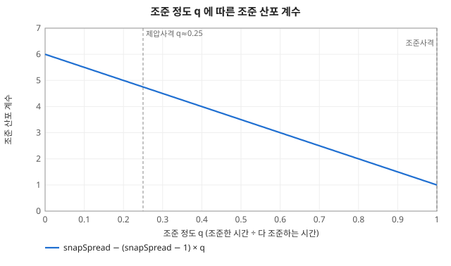
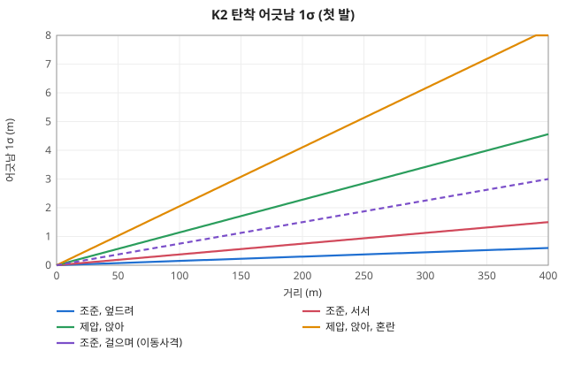
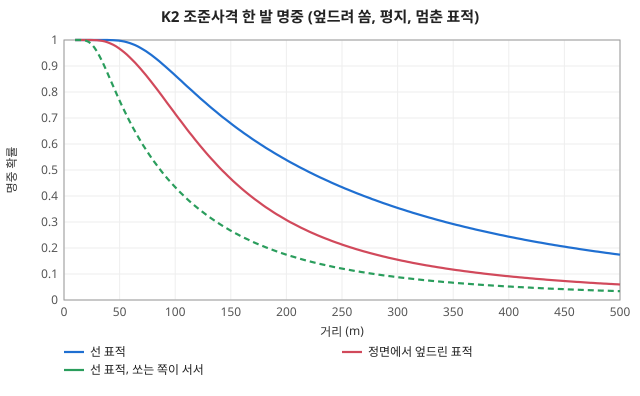
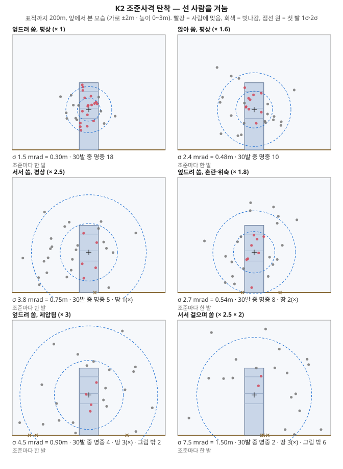
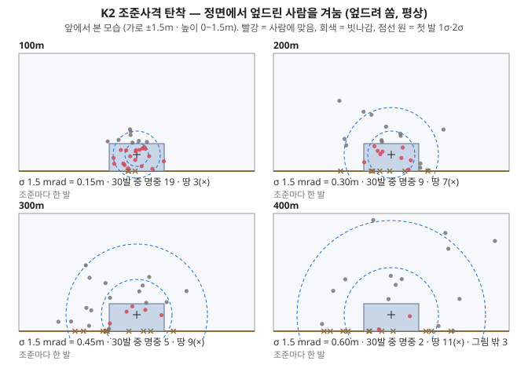
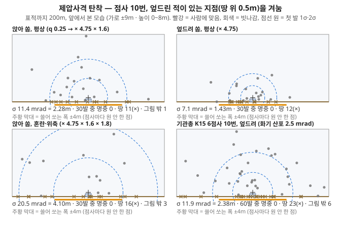
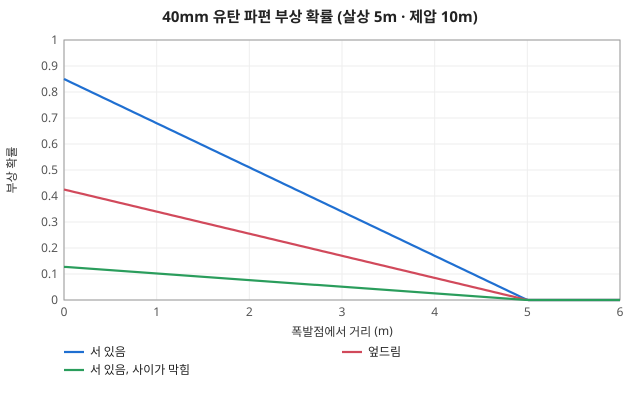
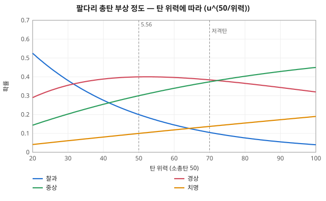

# 사격 계산

코드: [`command/action.ts`](../../packages/sim/src/command/action.ts) `fireStep` (조준·당김), [`combat/volume.ts`](../../packages/sim/src/combat/volume.ts) `planPull` (사격량), [`combat/fire.ts`](../../packages/sim/src/combat/fire.ts) `pullTrigger` (한 발), [`body/wound.ts`](../../packages/sim/src/body/wound.ts) `rollWound` (부상).
행동 필드는 [../objects/action.md](../objects/action.md), 화기·탄약 값은 [../objects/equipment.md](../objects/equipment.md). 난수 쓰는 곳은 [random/rolls.md](random/rolls.md).

탄 하나하나를 날리지 않는다. 방아쇠를 당긴 틱에 탄도선을 그어 바로 판정하고, 결과는 `World.shots`(화면 효과용)에 남긴다.

## 1. 명령 → 조준 계수·사격량 (`FIRE_ORDER`, [`command/command.ts`](../../packages/sim/src/command/command.ts))

| 명령 | 조준 시간 `aim` = 기준 조준 시간 × 조준 계수 | 사격량 (§2c) | 쓸어 쏘는 영역 |
|---|---|---|---|
| `fire` 조준사격 (아는 적) | 화기 `baseAimTime` × 1 | 기준 한 발 (낮은 사격량) | 0 |
| `suppress` 제압사격 (지점) | 화기 `baseAimTime` × 0.25 | 연사 속도에서 나온 기준 발 수 | 사격 부대가 정함 (§2a) |
| `suppress` 곡사 화기 | 화기 `baseAimTime` × 1 | 기준 한 발 | 없음 (지점 그대로) |
| `move` + `fire` 이동사격 | 위와 같음 (표적이면 조준, 지점이면 제압) | | |

세 사격 명령(`fire`·`suppress`·`move`+`fire`)과 부대 임무 `suppress` 는 `volume`(사격량)을 줄 수 있다 (§2c). 빼면 기준 그대로.

## 2. 조준 (`fireStep`)

```
조준 시간 계수 slow = FIRE.stressAim[심리] × 팔 aim × (실혈이면 1.3)
조준 틱 need = round(vary(aim × slow, ±25%) × 4)        점사마다 새로 굴림. aim = 기준 조준 시간 × 조준 계수 (§1)
조준 정도 q = (조준한 틱 × 0.25) ÷ (화기 baseAimTime × slow)  0 ~ 1 로 자름
```
- `FIRE.stressAim`: 평상·위협 1, 혼란 1.6, 제압·패닉 3. 팔 `WOUND.arm`: 저하 1.4, 한 팔 2.
- 조준사격은 q ≈ 1 (흔들림으로 0.75 ~ 1), 제압사격은 q ≈ 0.25.
- 다 조준하면 이번 당김의 발 수와 당김 뒤 쉴 틱 수를 정한다 (§2c). 화기마다 정해 둔 점사 상수는 없다.
- 제압사격은 당김이 끝나면 쉼 틱을 센 뒤 다시 조준한다 (쉼은 조준 정도 q 에 들어가지 않는다).
- 겨눌 자리 = 조준점 + 쓸어 쏘는 영역에서 고른 점 (§2a, 조준사격은 0) + 겨눔 어긋남 (가로·세로 각각 정규, 표준편차 `VARY.hold 0.5 × dispersion × 거리`). 점사 하나 안의 탄은 같은 자리를 겨눈다.
- 한 틱에 당기는 발 수 = `max(1, round(rof ÷ 60 × 0.25))`: K2 3, K15 3, AK 3, RPD 3, SVD·유탄·RPG 1. 당김이 끝나거나 탄창이 비면 다시 조준부터.


*조준을 덜 할수록 산포가 커진다 (제압사격 ≈ × 4.75)*

## 2a. 쓸어 쏘는 영역 (제압사격, [`combat/sweep.ts`](../../packages/sim/src/combat/sweep.ts) `pickSweep`)

명령은 지점만 준다. 영역은 쏘는 병사가 점사마다 **자기가 아는 접촉**(`knownOf(w, 병사)`, 직접 본 것과 들은 것)과 거리로 정한다. 실제 적 위치는 보지 않는다.

```
근거 접촉 = 명령 지점에서 gather 15 m 안의 아는 접촉
모호 반경 vague = baseVague 3 m + vagueDistCoef 0.01 × 사수↔지점 거리
```
| 근거 접촉 | 영역 | 겨눌 자리 |
|---|---|---|
| 없음 | 지점 둘레 모호 반경 | 지점 + `inDisk(vague)` |
| 가장 먼 두 접촉이 `lineMin` 3 m 안 (한 덩어리) | 접촉 무게중심 둘레. 전부 지금 보이면 `pad` 1.5 m, 마지막 위치만 아는 접촉이 있으면 모호 반경 | 무게중심 + `inDisk(반경)` |
| 줄로 퍼짐 | 가장 먼 두 접촉 A→B (x, y 작은 쪽이 A) 를 잇는 선, 둘레 `pad` | t = (내 몫 번호 + U[0,1)) ÷ 몫 수, A + (B−A)·t + `inDisk(pad)` |

- 몫 수 = 같은 제압 명령의 `ids` 길이, 내 몫 번호 = 그 안의 순서. 여럿이 한 줄을 제압하면 선을 몫 수로 나눠 각자 자기 토막에서만 고른다.
- 접촉은 마지막으로 본 위치다 (안 보이게 된 적은 옛 자리). 못 알아본 적은 근거가 아니다 — 처음 몇 점사는 모호 반경으로 쏘다가 적을 알아보면 영역이 좁아진다.
- 건물 벽·산울타리 같은 지형 윤곽은 아직 쓰지 않는다 (아는 접촉의 퍼짐만).

## 2b. 사선 안전 ([`combat/clearline.ts`](../../packages/sim/src/combat/clearline.ts), #79)

사수 → 겨눌 자리 선 위(또는 가까이)에 **사수 눈에 보이는 아군**(투과 `VISION.track` 이상, 안 보이는 아군은 모름)이 있으면 쏘지 않는다. 명령에 `risk` 가 있으면 이 점검을 건너뛴다 (맞으면 보통 부상 경로).

```
막힘 = 아군이  minAlong 0.8 m ≤ 선 따라 거리 ≤ 사수↔겨눌 자리 거리  이고
       선에서 옆으로 떨어진 거리 ≤ 여유 baseMargin 0.75 m + 산포 폭 계수 spreadCoef 3 × (기준 산포 ÷ 1000) × 선 따라 거리
```
| 상황 | 동작 (`FireAction.line`) |
|---|---|
| 안 막힘 | `clear`. 쏨 |
| 조준사격이 막힘, 서서 쏨 | 사선 수직으로 `steps` 1.5 → 3 → 4.5 m, 좌·우 차례로 걸어갈 수 있는 땅의 첫 트인 자리를 찾아 걸어감 (`reposition`). 자리에 닿으면 다시 점검 |
| 비켜 설 자리가 없음, 또는 걸으며 쏨 | 쏘지 않고 기다림 (`hold`). 선이 트이면 이어 쏨 |
| 제압사격 | 점사마다 고른 겨눌 자리 선이 막혔으면 그 점사만 버리고 다시 조준 (`hold`). 막히지 않은 선은 그대로 쏨. 점사 도중 막히면 멈춤 |

- 자세(엎드림 등)는 바꾸지 않고, 엄폐·명령 영역 안에 머무는지는 아직 보지 않는다 (비켜 서는 거리가 최대 4.5 m 라 작다).
- 상수: `LINE.baseMargin` 0.75 m, `spreadCoef` 3, `minAlong` 0.8 m, `steps` [1.5, 3, 4.5] m. 모두 추정값 (조사 근거 없음).
- 난수를 굴리지 않는다 (`random/rolls.md` 변화 없음).

## 2c. 사격량 (`FIRE_VOLUME`, [`combat/volume.ts`](../../packages/sim/src/combat/volume.ts) `planPull`, #26)

명령이 기준 사격량을 주고, 병사가 상황·상태·방아쇠 조절로 한 번 당길 발 수와 당김 사이 쉼을 정한다. 능력치는 쓰지 않는다 (명령·상황·상태·시드 잡음뿐).

```
명령 volume : 단계 slow / normal / rapid (발 수 계수·쉼 계수)  또는  한 번에 당길 발 수(숫자). 빼면 normal
기준 발 수 nominal = 숫자면 그 값
                   = 아니면 (제압사격 ? max(1, rof ÷ 60 × basePull 0.3) : 1) × 단계 발 수 계수
상황 계수 = 거리 계수 × 표적 뚜렷함 계수 × 심리 계수          (아래 표, 발 수 계수·쉼 계수 각각)
아낌 계수 ammoCoef = 지닌 탄 ≥ 30발이면 1, 아니면 0.4 + 0.6 × 지닌 탄 ÷ 30
템포 cadence      = clamp(1 + (직전 − 1) × 0.7 + gauss × 0.15, 0.6, 1.6)     제압사격 당김마다 서서히 흔들림
발 수 rounds = max(1, round(nominal × 상황 발 수 계수 × ammoCoef × cadence × exp(gauss × 0.25)))
쉼 틱 pause  = round(basePause 0.25 × 단계 쉼 계수 × 상황 쉼 계수 ÷ (ammoCoef × cadence) × exp(gauss × 0.5) × 4)   제압사격만
```
- 기준이 한 발(조준사격·곡사·저격총)이고 숫자로 주지 않았으면 발 수는 굴리지 않고 1발이다 (한 발씩 신중하게). 쉼과 템포는 제압사격(`judge`)만 굴린다.
- 단계: slow 발 수 × 0.5 · 쉼 × 2, normal 1 · 1, rapid 발 수 × 2 · 쉼 × 0.4. 숫자(예 6)는 단계 계수를 안 쓰고 그 발 수를 기준으로 한다.
- 방아쇠 조절: 로그 표준편차 0.25 라서 기준 6발이면 대략 4 ~ 9발에 몰린다. 지닌 탄은 장전된 탄을 포함한 그 화기 탄약 수.

| 상황 | 발 수 계수 | 쉼 계수 |
|---|---|---|
| 겨눌 자리까지 50 m 안 (가까움) | 1.3 | 0.8 |
| 200 m 너머 (멂) | 0.8 | 1.2 |
| 쏠 근거가 전부 지금 보임 (`exposed`: 한 점·한 덩어리 접촉이 다 visible) | 1.2 | 0.9 |
| 쏠 근거가 없음 (`unclear`: 지점 둘레 모호 반경) | 0.85 | 1.15 |
| 위축(`shaken`)·제압(`suppressed`) | 1.3 | 0.8 |

모든 수치는 추정이다 (공개 교범에서 확인한 값이 아니다). 근거가 일부만 보이면(`mixed`) 계수 1. 조준사격은 표적이 보이니 `exposed` 로 본다.

## 3. 산포 (`pullTrigger`)

```
σ (rad) = 기준 산포 dispersion ÷ 1000 × 조준 산포 계수 × 쏘는 사람 계수 × (1 + 0.3 × 점사 안 순번) × (1 + 0.3 × 표적 속도 m/s)
조준 산포 계수 = 6 − 5 × q                       (바로 쏨 6 → 다 조준 1)
쏘는 사람 계수 = 자세 × 심리 × 팔 × 실혈 × 이동사격
```

| 쏘는 사람 계수 항 | 값 | 상수 |
|---|---|---|
| 자세 | 서기 2.5, 앉아 1.6, 엎드려 1 | `FIRE.posture` |
| 심리 | 평상 1, 위협 1.1, 혼란 1.8, 제압·패닉 3 | `FIRE.stressSpread` |
| 팔 | 저하 1.8, 한 팔 4, 두 팔 못 씀 → 쏘지 못함 | `WOUND.arm` |
| 실혈 (30% 넘게) | 1.5 | `WOUND.weak.spread` |
| 이동사격 | 2 | `FIRE.movingSpread` |
| 점사 반동 | 발마다 + 0.3 (첫 발 0) | `FIRE.climb` |
| 움직이는 표적 | m/s 당 + 0.3 (표적이 `moving` 이면 그 걸음의 `speedOf`) | `FIRE.leadError` |


*거리와 사격 방식별 탄착 어긋남 1σ (점사 반동·흔들림 전)*


*한 발 명중 확률 근삿값 (지물·지형 없음)*

### 탄착 분포로 보기
위 식대로 30발씩 실제로 굴려 표적 쪽에서 본 그림 (`npm run charts` 가 시드를 고정해 그림). 사람 상자 안의 옅은 선은 부위 경계(머리·가슴·복부·다리), + 는 조준점, 점선 원은 첫 발 1σ·2σ, × 는 땅에 박힌 탄.


*같은 K2 조준사격도 서서 쏘거나(× 2.5) 눌리면(× 1.8 ~ 3) 원이 커져 200m 선 사람에게 맞는 수가 18 → 4~5 발로 준다*


*엎드린 사람은 높이가 0.35m 라 거리가 멀어지면 대부분 앞 땅에 박힌다*


*제압사격은 조준을 1/4 만 해서(× 4.75) 맞히기보다 지점 둘레 몇 m 에 탄을 뿌린다. 그 탄들이 곁의 사람을 누르는 양은 [rates.md](rates.md) "근탄"*

## 4. 직사 탄도

- 총구 = 발 딛은 높이 + 몸 높이 × 0.85 (`FIRE.muzzleHeight`). 조준점 = 표적 발 + 몸 높이 × 0.6 (`aimHeight`, 둔덕 위로 드러난 몸 가운데보다 낮지 않게 `aimZ`), 지점이면 땅 + 0.5m.
- 방위각·앙각에 각각 `정규 × σ` 를 더한 직선. 최대 거리 = 유효사거리 × 2 (`FIRE.maxRange`).
- **사람**: 탄도선 앞쪽, 수평 거리 가장 가까운 사람부터 (쏜 사람·죽은 사람 제외, 아군 포함).
  - 옆 어긋남 ≤ 반폭: 선·앉음 = 어깨 폭/2 (0.25m). 엎드림 = `(|sin| × 키 + |cos| × 0.7) / 2` (정면 0.35m ~ 옆 0.875m), sin·cos 는 몸 축과 탄도선 사이 각.
  - 높이: 그 거리에서 탄도선 높이가 표적 발 ~ 머리 사이 (`zf` = 0 ~ 1).
  - 둔덕(도랑·참호) 끝에서 탄도선이 지면 이하면 흙에 막힌다.
- **지물·땅** (`traceTerrain`): 총구 1m 앞부터 0.5m 마다, 지도 밖 · 땅(바닥) 이하 → 탄착. 지물 높이 안이면 0.5m 마다 `1 − exp(−밀도 × 0.25)` 확률로 멈춤 (m 당 `1 − exp(−밀도 × 0.5)`: 숲 3.9%, 생울타리 22%, 건물·담 99%).
- 사람보다 지물이 먼저 막으면 맞지 않는다.

### 맞은 부위
| 자세 | 규칙 (`FIRE.partHeight`, `pronePart`, `proneEnd` 0.35, `proneCore` 0.4, `armOffset` 0.6) |
|---|---|
| 선·앉음 | 높이 zf ≥ 0.87 머리, ≥ 0.62 가슴 (가운데에서 반폭의 60% 밖이면 그쪽 팔), ≥ 0.47 복부, 아래 다리 (왼쪽·오른쪽은 어긋난 쪽) |
| 엎드림, 정면 (\|sin\| < 0.35) | 가운데 40% 안 머리, 밖은 팔 |
| 엎드림, 뒤 | 가운데 40% 안 복부(엉덩이), 밖은 다리 |
| 엎드림, 옆·비스듬히 | 탄도선이 몸 축을 지나는 자리 u (발 0 → 머리 1): ≥ 0.86 머리, ≥ 0.6 가슴 (거의 정면·뒤면 쏜 쪽 팔), ≥ 0.45 복부, 아래 쏜 쪽 다리 |

## 5. 곡사·폭발

- **곡사** (유탄): 탄도선 없이 조준점 둘레에 떨어진다. 탄착 = 조준점 + (정규 × σ × 수평 거리) 를 x·y 에 각각. 지물을 넘어간다.
- **장전 거리** (`armingDist`, 탄약 필드 #31): 쏜 자리에서 이 거리보다 가까이 떨어진 탄은 신관이 장전되지 않아 터지지 않는다(불발, 로그 한 줄). 곡사는 탄착점, 직사(PG-7V)는 탄도선 끝(맞은 곳)까지 잰다. 40mm 14 m, PG-7V 8 m.
- **폭발** (곡사탄 전부, 폭발하는 직사탄은 탄착점에서): 폭발점(땅 + 0.5m)에서 산 사람마다
  - 차폐 = 폭발점 → 몸 가운데 시선 투과율 × 둔덕 노출 비율. 0.2 이하면 × 0.15 (`blastLos`, `blastShield`), 아니면 1.
  - 제압 반경 안: 스트레스 `40 × (1 − 거리/제압 반경) × 차폐` (± 30%).
  - 파편 부상 확률 (`blastChance`): 살상 반경 R 안은 `0.85 × (1 − d/R)`, 사상 반경 C(`casualtyRadius`)가 있는 탄은 R 너머 C 까지 `blastTail × (1 − (d−R)/(C−R))` 꼬리(R 에서 0.03 → C 에서 0). 여기에 × (엎드림 0.5) × 차폐. 사상 반경이 없는 탄은 R 에서 끝. 부위는 자세별 비율표 `FIRE.blastPart` 에서 뽑고, 위력 = `damage × (1 − 0.6 × (1 − near))` (꼬리에서는 near = 0).


*K200 파편 부상 확률 — 살상 반경 5m 안은 선형, 사상 반경 130m 까지 꼬리. 엎드리면 × 0.5, 막히면 × 0.15*

### 기준표 — 40mm K200 파편 부상 확률 (거리 × 자세, #31)

**전부 추정 표다.** 교범이 주는 것은 경계(살상 5 m, 130 m 안 사상, 장전 14~27 m)뿐이고, 거리별 확률·엎드림·엄폐 감소율은 개방 자료에서 못 찾았다 ([research/31-explosives.md](../research/31-explosives.md)). 아래 값은 위 식(`blastChance`)을 적은 것이고, `combat/blast.test.ts` 가 표 = 식, 그리고 시뮬레이션 6000회 결과가 표와 ±0.02 안(막힘은 벽 뒤 4 m)인지 본다.

| 폭발점에서 거리 | 서 있음 | 엎드림 | 사이가 막힘 (서 있음) |
|---|---|---|---|
| 1 m | 0.68 | 0.34 | 0.102 |
| 3 m | 0.34 | 0.17 | 0.051 |
| 4.5 m | 0.085 | 0.043 | 0.013 |
| 6 m | 0.030 | 0.015 | 0.0045 |
| 20 m | 0.026 | 0.013 | 0.0040 |
| 60 m | 0.017 | 0.0084 | 0.0025 |
| 120 m | 0.0024 | 0.0012 | 0.0004 |

탄착 산포(사거리별)는 표를 만들지 않았다: K201 15 · G-25 18 · RPG-7 3 mrad 는 추정 유지, 교범은 "표적 5 m 안 탄착이면 명중" 판정만 준다 (FM 3-22.31 PDF 68쪽). 확률오차 사격표(TM 3-22.31)는 못 구했다.

## 5a. 수류탄 투척 ([`combat/grenade.ts`](../../packages/sim/src/combat/grenade.ts), #37)

- **거리**: 닿는 거리 = `throwRange × THROW.rangeCoef[자세] × max(minLoadCoef, 1 − loadCoef × max(0, 하중 − baseLoad))`. 목표가 이보다 멀면 명령 거부.
- **준비 시간**: `basePrepTime × THROW.prepCoef[자세] × FIRE.stressAim[심리] × 팔 조준 계수 (× 약해졌으면 WOUND.weak.aim)`, ± `VARY.aim`.
- **산포**: 던진 자리 = 목표 + (정규 × σ) 를 x·y 에, σ = `dispersion/1000 × FIRE.stressSpread[심리] × 팔 산포 계수 (× weak.spread) × 던지는 거리`. 어긋난 자리가 닿는 거리 밖이면 그 방향으로 닿는 데까지.
- **포물선**: 손 높이 `몸 높이 × releaseHeight` 에서 `꼭대기 = apexCoef × 거리` 의 포물선으로 `THROW.step` 간격으로 따라가며, 칸의 지물 밀도가 `THROW.solid` 이상이고 포물선이 지물 높이(`p.height`) 아래이면 막혀 `bounceBack` 앞에 떨어진다. 숲·덤불·울타리는 지나간다.
- **신관**: `rng.int(secToTicks(fuseMin), secToTicks(fuseMax))` 틱 뒤에 폭발. 폭발은 §5 와 같은 `explode` (살상·제압 반경은 수류탄 제원). 떨어진 높이는 `floorAt + pointAimHeight` — 참호·도랑 바닥에 떨어지면 바닥 높이라 둔덕에 가리지 않고 안의 사람이 파편을 받는다. 아군도 맞는다.
- **소리**: 던질 때는 소리가 없고(자취만), 터질 때 폭발음 `soundRange` (§ 듣기, 곡사와 같이 쏜 곳을 모른다).

| 상수 | 값 | 하는 일 | 키우면 |
|---|---|---|---|
| `THROW.rangeCoef` | 서서 1 · 앉아 0.85 · 엎드려 0.6 | 자세별 투척 거리 계수 (추정) | 낮은 자세도 멀리 던짐 |
| `THROW.prepCoef` | 서서 1 · 앉아 1.2 · 엎드려 2 | 자세별 투척 준비 시간 계수 (추정) | 낮은 자세의 준비가 오래 걸림 |
| `THROW.baseLoad` | 20 kg | 이를 넘는 하중부터 투척 거리가 준다 (추정) | |
| `THROW.loadCoef` | 0.01 | 기준 하중을 넘는 kg 당 투척 거리 감소 비율 (추정) | 무거운 병사가 덜 던짐 |
| `THROW.minLoadCoef` | 0.6 | 하중에 따른 투척 거리 계수의 하한 (추정) | |
| `THROW.releaseHeight` | 1 | 손 높이 = 몸 높이 × 이 값 | 낮은 지물을 더 잘 넘김 |
| `THROW.apexCoef` | 0.12 | 포물선 꼭대기 = 거리 × 이 값 (추정) | 높은 지물을 더 잘 넘김 |
| `THROW.step` | 0.5 m | 포물선 검사 간격 | |
| `THROW.solid` | 1 | 이 밀도 이상의 지물이 수류탄을 막는다 (건물·담 10, 생울타리 0.5 는 통과) | 더 성긴 지물도 막음 |
| `THROW.bounceBack` | 0.5 m | 막힌 곳에서 던진 쪽으로 떨어지는 거리 | |
| 수류탄 `K413` | 0.4 kg · 4~5 s · 35 m · 60 mrad · 준비 1.5 s · 살상 5 m · 제압 15 m · 피해 60 · 소리 1000 m | M67 값을 K413 대용으로 (출처 [../research/31-explosives.md](../research/31-explosives.md): 살상 5 m·신관 4~5 s·투척 35 m 확인, 제압 15 m 는 "유효 사상 반경 15 m" 를 제압 반경으로 쓴 추정, 산포·준비 시간·피해·무게는 추정) | |

## 6. 근탄 (직사, 폭발하지 않는 탄)

탄도선 선분(총구 → 탄착점)과의 거리 d 가 탄약 `suppressionRadius` R 안인 산 사람 (쏜 사람·맞은 사람 제외, 아군 포함):
```
scale = (1 − d / R) × 구경 계수 × (1 − 0.6 × 발밑 엄폐) × (움직이면 1.15)
```
→ `nearMiss` 가 몰아쏘기 계수를 곱해 스트레스를 올린다 ([rates.md](rates.md) "스트레스"). R: 5.56mm 3m (구경 계수 1), 7.62×39·7.62×54R 6m (구경 계수 0.6). 반경은 2차 출처(원 시험 미확인), 구경 계수는 DARPA 1972 표 5-7 (M16 35 : M60 43) 에 반경 3m:6m 의 평균 기여를 맞춘 추정이다 ([../research/23-suppression.md](../research/23-suppression.md)). 근탄만으로 올라가는 스트레스는 `RATES.stress.nearMissCap` 에서 멈춘다 ([rates.md](rates.md)).

## 7. 부상 (`rollWound`)

- 확률표 `WOUND.bullet` / `WOUND.fragment` (부위 묶음: 머리·가슴·복부·팔다리) 에서 정도를 뽑는다. 균등 난수 u 를 `u^(50 / 위력)` 으로 바꿔 누적표에 넣는다 → 위력이 50 보다 크면 무거운 쪽으로 밀린다 ([random/rolls.md](random/rolls.md) "부상 정도").
- 출혈 = `baseBleed(부위, 정도) × (1 ± 40%)` (기준 사망 시간에서 셈, [rates.md](rates.md) "혈액").
- 맞은 사람: 스트레스 `30 ± 30%`, 그다음 정도별 확률로 쇼크 (찰과 0.02 · 경상 0.1 · 중상 0.6 · 치명 0.9 → 바로 패닉).

| 총탄 부위 | 찰과 | 경상 | 중상 | 치명 |
|---|---|---|---|---|
| 머리 | 0 | 0 | 0.1 | 0.9 (즉사) |
| 가슴 | 0 | 0 | 0.55 | 0.45 |
| 복부 | 0 | 0 | 0.6 | 0.4 |
| 팔다리 | 0.2 | 0.4 | 0.3 | 0.1 |

| 파편 부위 | 찰과 | 경상 | 중상 | 치명 |
|---|---|---|---|---|
| 머리 | 0.3 | 0.2 | 0.2 | 0.3 |
| 가슴·복부 | 0.3 | 0.3 | 0.25 | 0.15 |
| 팔다리 | 0.35 | 0.4 | 0.2 | 0.05 |


*위력이 커지면 가벼운 부상이 줄고 무거운 부상이 는다*

## 계산 예

대략값: 평지, 지물 없음, 표적 멈춤. 한 발이 사람 판정 상자를 지날 확률만 본다 (가로 = 산포 + 겨눔 어긋남, 세로 = 산포).

| 상황 | σ | 거리 100 / 200 / 300m 명중 |
|---|---|---|
| K2 조준사격, 엎드려, 평상 → 선 표적 | 1.5 mrad (200m 에서 0.3m) | 0.86 / 0.54 / 0.35 |
| 같음 → 정면에서 엎드린 표적 | 1.5 mrad | 0.72 / 0.31 / 0.15 |

| 상황 | σ (첫 발 → 셋째 발) | 200m 에서 어긋남 1σ |
|---|---|---|
| K2 제압사격, 앉아, 평상 (q 0.25) | 1.5 × 4.75 × 1.6 = 11.4 → 18.2 mrad | 2.3 → 3.6 m (+ 쓸어 쏘는 4m 원) |
| 같음, 혼란 (산포 × 1.8, 조준 × 1.6 → q 0.25 그대로) | 20.5 → 32.8 mrad | 4.1 → 6.6 m |
| K201 유탄, 엎드려, 다 조준 | 15 mrad | 탄착 3m (살상 5m · 제압 10m) |
| K2 조준사격, 서서 걸으며 (이동사격) | 1.5 × 2.5 × 2 = 7.5 mrad | 1.5 m |

| 폭발 | 확률·위력 |
|---|---|
| 40mm 유탄이 엎드린 사람 1m 옆 (살상 5m) | 0.85 × 0.8 × 0.5 = 0.34, 위력 60 × 0.88 = 53 |
| 같은 자리 서 있는 사람 | 0.68, 다리 42% · 가슴 18% … |
| 같은 자리, 사이에 담 | × 0.15 → 0.05 (서 있으면 0.10) |

## 상수 — 무엇을 하나

### 쓸어 쏘는 영역 (`SWEEP`, [`combat/sweep.ts`](../../packages/sim/src/combat/sweep.ts))
| 상수 | 값 | 하는 일 | 키우면 |
|---|---|---|---|
| `SWEEP.gather` | 15 m | 명령 지점에서 이 안의 아는 접촉을 영역 근거로 삼음 | 멀리 흩어진 접촉까지 한 줄로 묶음 |
| `SWEEP.pad` | 1.5 m | 접촉·줄 둘레 여유 반경 (보이는 한 점이면 이만큼만 흩뿌림) | 정확히 아는 적도 넓게 쏨 |
| `SWEEP.baseVague` | 3 m | 기준 모호 반경 (근거 없음·마지막 위치만 앎) | 모를 때 더 넓게 흩뿌림 |
| `SWEEP.vagueDistCoef` | 0.01 m/m | 모호 반경에 사수↔지점 거리를 곱해 더하는 계수 (100 m → +1 m) | 먼 곳일수록 더 넓게 |
| `SWEEP.lineMin` | 3 m | 접촉 퍼짐이 이보다 짧으면 줄이 아니라 한 덩어리로 봄 | 줄 판정이 줄어듦 |

### 조준·산포 (`FIRE`, `FIRE_ORDER`, `WOUND.arm`·`weak`)
| 상수 | 값 | 하는 일 | 키우면 |
|---|---|---|---|
| `FIRE_ORDER.aimed.aimCoef` | 1 | 조준사격의 조준 계수: 조준 시간 = 화기 기준 조준 시간 `baseAimTime` × 이 값 | 조준사격이 느리고 정확해짐 (q 는 1 에서 막힘) |
| `FIRE_ORDER.suppress.aimCoef` | 0.25 | 제압사격의 조준 계수 (기준 조준 시간에 곱함). 조준 정도 q 도 대략 이 값이 됨 | 제압사격이 느려지고 덜 흩어짐 |
| `FIRE.snapSpread` | 6 | 조준 없이(q = 0) 쏠 때 산포 계수. q 에 따라 6 → 1 로 선형 | 덜 조준한 사격이 더 빗나감 |
| `FIRE.posture` | 서 2.5 · 앉 1.6 · 엎 1 | 쏘는 사람 자세별 산포 계수 (엎드려 받치면 1) | 그 자세 사격이 더 빗나감 |
| `FIRE.stressSpread` | 평 1 · 위협 1.1 · 혼란 1.8 · 제압·패닉 3 | 심리 단계별 산포 계수 (눌리면 반격이 부정확) | 눌린 병사 사격이 더 빗나감 |
| `FIRE.stressAim` | 평·위협 1 · 혼란 1.6 · 제압·패닉 3 | 심리 단계별 조준 시간 계수 (눌리면 반격이 뜸해짐) | 눌린 병사가 더 드물게 쏨 |
| `FIRE.movingSpread` | 2 | 걸으며 쏠 때 산포 계수 | 이동사격이 더 빗나감 |
| `FIRE.climb` | 0.3 | 점사 안에서 발마다 더해지는 산포 (반동). 셋째 발 × 1.6 | 연사 뒷발이 더 흩어짐 |
| `FIRE.leadError` | 0.3 | 표적 속도 1 m/s 당 더해지는 산포 (앞질러 겨누는 어긋남) | 움직이는 표적이 더 맞기 어려움 |
| `WOUND.arm.impaired` / `one` | 산포 1.8 · 조준 1.4 · 재장전 1.8 / 4 · 2 · 3 | 팔 경상 / 한 팔 못 씀일 때 사격 계수. 두 팔 다 못 쓰면 쏘지 못함 | 팔 다친 병사가 더 못 쏨 |
| `WOUND.weak.spread` / `aim` | 1.5 / 1.3 | 피를 30% 넘게 잃었을 때 산포·조준 시간 계수 | 실혈한 병사가 더 못 쏨 |
| `VARY.aim` | ± 25% | 당김마다 조준 시간 흔들림 | 사격 간격이 더 들쭉날쭉 |
| `VARY.hold` | 0.5 | 점사마다 겨눔 자체의 어긋남 = 화기 산포 × 이 값 × 거리 (점사 안 탄이 함께 쏠림) | 점사 전체가 한쪽으로 더 쏠림 |

### 사격량 (`FIRE_VOLUME`, §2c)
| 상수 | 값 | 하는 일 | 키우면 |
|---|---|---|---|
| `FIRE_VOLUME.basePull` | 0.3 s | 기준 당김 시간: 제압사격 기준 발 수 = rof ÷ 60 × 이 값 (K2 3.5, K15 4) | 한 번에 더 길게 당김 |
| `FIRE_VOLUME.basePause` | 0.25 s | 제압사격 당김 사이 기준 쉼 | 더 드문드문 쏨 |
| `FIRE_VOLUME.level` | slow 0.5·2 / normal 1·1 / rapid 2·0.4 | 단계별 발 수 계수·쉼 계수 | 단계 차이가 커짐 |
| `FIRE_VOLUME.trigger` | 0.25 | 방아쇠 조절: 발 수 로그 표준편차 | 발 수가 더 크게 갈림 |
| `FIRE_VOLUME.pauseSpread` | 0.5 | 쉼 로그 표준편차 | 쉼이 더 들쭉날쭉 |
| `FIRE_VOLUME.cadence` | 유지 0.7 · 흔들림 0.15 · 0.6 ~ 1.6 | 임무 중 서서히 바뀌는 템포 | 임무가 더 굽이침 |
| `FIRE_VOLUME.close` / `far` | 50 m 안 1.3·0.8 / 200 m 너머 0.8·1.2 | 거리 계수 (발 수·쉼) | 거리 영향이 커짐 |
| `FIRE_VOLUME.exposed` / `unclear` | 1.2·0.9 / 0.85·1.15 | 표적 뚜렷함 계수 | 뚜렷함 영향이 커짐 |
| `FIRE_VOLUME.stress` | 위축·제압 1.3·0.8, 나머지 1 | 심리 계수 | 눌린 병사가 더 몰아 쏨 |
| `FIRE_VOLUME.lowAmmo` | 30발 · 최소 0.4 | 지닌 탄이 이 아래면 아낌 계수가 0.4 까지 줄고 쉼은 그만큼 늘어남 | 일찍부터 아낌 |

### 탄도·피탄 (`FIRE`)
| 상수 | 값 | 하는 일 | 키우면 |
|---|---|---|---|
| `FIRE.maxRange` | 2 | 탄도선을 따라가는 최대 거리 = 유효사거리 × 이 값. 그 너머는 땅에 떨어진 것으로 봄 | 먼 사람도 맞을 수 있음 |
| `FIRE.traceStep` | 0.5 m | 탄도선이 땅·지물을 검사하는 간격 | 검사가 성겨짐 (얇은 지물을 건너뛸 수 있음) |
| `FIRE.muzzle` | 1 m | 총구 바로 앞 이 거리는 지물 검사에서 뺌 (숲·담 뒤에서도 밖으로 쏨) | 더 두꺼운 은폐물 뒤에서도 쏠 수 있음 |
| `FIRE.stopPerDensity` | 0.5 | 지물이 탄을 멈추는 정도. 1m 당 멈출 확률 = `1 − exp(−밀도 × 이 값)` | 숲·울타리가 탄을 더 잘 막음 |
| `FIRE.muzzleHeight` | 0.85 | 총구 높이 = 몸 높이 × 이 값 | 총구가 높아져 둔덕·참호 너머로 쏘기 쉬움 |
| `FIRE.aimHeight` | 0.6 | 사람을 겨누는 높이 = 표적 몸 높이 × 이 값 (몸통 가운데) | 더 위(가슴·머리 쪽)를 겨눔 |
| `FIRE.pointAimHeight` | 0.5 m | 지점 사격·폭발점의 땅 위 높이 | 지점 사격 탄도가 높아짐 |
| `FIRE.partHeight` | 머리 0.87 · 가슴 0.62 · 복부 0.47 | 선·앉은 몸에서 맞은 높이(발 0 → 머리 1)로 부위를 가르는 경계 | 그 부위 아래 칸이 넓어짐 (예: head 를 키우면 머리가 덜 맞음) |
| `FIRE.armOffset` | 0.6 | 가슴 높이에서 몸 가운데로부터 반폭의 이 비율 밖이면 팔 | 팔이 덜 맞고 가슴이 더 맞음 |
| `FIRE.proneWidth` | 0.7 m | 엎드린 사람을 정면에서 본 폭 (팔꿈치를 벌린 자세). 옆에서는 키 | 엎드린 사람이 정면에서 더 잘 맞음 |
| `FIRE.proneEnd` | 0.35 | 몸 축과 탄도선 사이 sin 이 이보다 작으면 "정면·뒤에서 온 탄" 으로 봄 | 정면·뒤 판정 범위가 넓어짐 |
| `FIRE.proneCore` | 0.4 | 정면에서 맞을 때 가운데 이 비율 안이면 머리 (밖은 팔), 뒤에서면 엉덩이 (밖은 다리) | 정면 탄이 머리에 더 맞음 |
| `FIRE.pronePart` | 머리 0.86 · 가슴 0.6 · 복부 0.45 | 엎드린 몸을 옆에서 맞힐 때 몸 축 위 자리(발 0 → 머리 1)로 부위를 가르는 경계 | partHeight 와 같음 |

### 폭발·근탄 (`FIRE`)
| 상수 | 값 | 하는 일 | 키우면 |
|---|---|---|---|
| `FIRE.blastHit` | 0.85 | 폭발 중심에서 파편에 다칠 확률 (살상 반경 끝에서 0 까지 선형, 추정) | 유탄이 더 잘 다치게 함 |
| `FIRE.blastTail` | 0.03 | 사상 반경이 있는 탄(K200 130 m)이 살상 반경 끝에서 갖는 꼬리 확률. 사상 반경 끝에서 0 까지 선형 (추정, #31) | 먼 거리 파편 부상이 늘어남 |
| `FIRE.proneBlast` | 0.5 | 엎드린 사람의 파편 부상 확률 계수 | 엎드려도 덜 보호됨 |
| `FIRE.blastFalloff` | 0.6 | 파편 위력이 살상 반경 끝에서 줄어드는 비율 (끝에서 × 0.4) | 멀리서 맞은 파편이 더 가벼워짐 |
| `FIRE.blastPart` | 자세별 비율표 | 파편이 맞는 부위 비율. 서 있으면 다리, 엎드리면 머리·몸통이 많음 | 그 부위가 더 자주 다침 |
| `FIRE.blastLos` | 0.2 | 폭발점 → 몸 시선 투과율이 이 이하면 "막혀 있음" 으로 봄 | 덜 막힌 엄폐물도 막는 것으로 침 |
| `FIRE.blastShield` | 0.15 | 막혀 있을 때 파편 부상 확률·폭발 스트레스 계수 | 엄폐물 뒤도 더 다침 |
| `FIRE.coverShield` | 0.6 | 근탄 스트레스를 발밑 엄폐가 줄이는 정도: × (1 − 이 값 × 엄폐) | 엄폐가 제압을 더 잘 막음 |
| `FIRE.moving` | 1.15 | 움직이는 사람이 받는 근탄 스트레스 계수 | 이동 중 더 쉽게 눌림 |
| 탄약 `blastRadius` | K200 5 m · VOG-25 6 m · PG-7V 3 m | 살상 반경. K200 5 m = FM 3-22.31 3-8·3-9 "kill radius of 5 meters" (확인). VOG-25 6 m = 위키류 2차(6~9 m·5 m 로 엇갈림). PG-7V 3 m = 추정. 근거 [../research/31-explosives.md](../research/31-explosives.md) | 살상 범위가 넓어짐 |
| 탄약 `casualtyRadius` | K200 130 m | 살상 반경 너머 꼬리가 닿는 거리. FM 3-22.31 3-8 "130 m 안 사상" (확인), 꼬리 모양은 추정 | 꼬리가 더 멀리 감 |
| 탄약 `armingDist` | 40mm 14 m · PG-7V 8 m | 이보다 가까이 떨어진 탄은 불발. 40mm 는 FM 3-22.31 3-8·3-9 "14~27 m 사이 장전" 하한(범위 확인·값 추정), PG-7V 는 VP-7M 2.5~15 m 의 중간(추정) | 불발 구간이 넓어짐 |
| 탄약 `suppressionRadius` | 3 · 6 · 6 m … | 근탄으로 치는 탄도선 둘레 거리 (폭발은 폭발점 둘레) | 더 먼 탄도 사람을 누름 |

### 부상 (`WOUND`)
| 상수 | 값 | 하는 일 | 키우면 |
|---|---|---|---|
| `WOUND.refPower` | 50 | 탄 위력 기준 (소총탄). 위력 ÷ 이 값이 1 보다 크면 부상 정도를 무겁게 민다 | 모든 탄이 상대적으로 가벼워짐 |
| `WOUND.bullet` / `fragment` | 위 표 | 부위 묶음별 (찰과, 경상, 중상, 치명) 확률. 합 1 | — |
