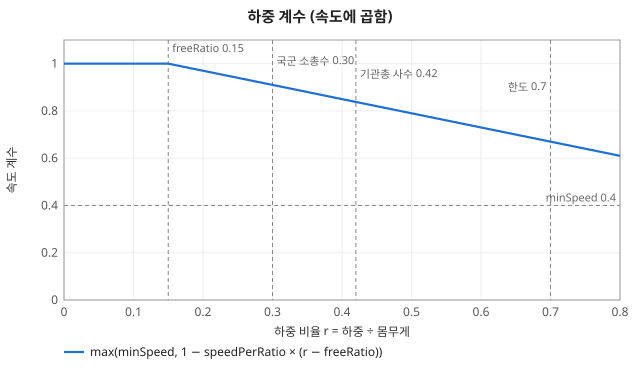
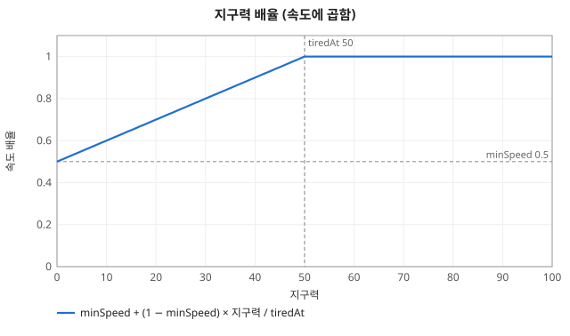
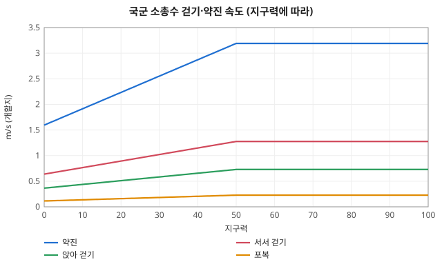

# 이동 계산

코드: [`body/soldier.ts`](../../packages/sim/src/body/soldier.ts) `speedOf`, [`command/action.ts`](../../packages/sim/src/command/action.ts) `ACTIONS.move`. 이동 행동의 필드는 [../objects/action.md](../objects/action.md).

## 낼 수 있는 속도 `speedOf(s, gait)` (m/s, 지형 계수 전)

```
속도 = 기준 속도 × 하중 계수 × 지구력 계수 × 다리 계수 × 실혈 계수
```

| 항 | 식 | 상수 |
|---|---|---|
| 기준 속도 | 걷기 = 자세별 (서기 1.4 · 앉아 0.8 · 포복 0.25). 약진 = 3.5 (서서 뜀). 약진을 못 하면 (다리 저하·실혈) 선 걸음 1.4. 다리 하나라도 못 쓰면, 자세를 바꾸는 중이면 무엇이든 포복 0.25 | `BASE_SPEED`, `RUSH_SPEED`, `canRush` |
| 하중 계수 | r = 하중 ÷ 몸무게, `max(minSpeed, 1 − speedPerRatio × max(0, r − freeRatio))` = `max(0.4, 1 − 0.6 × max(0, r − 0.15))` | `LOAD.freeRatio` 0.15, `speedPerRatio` 0.6, `minSpeed` 0.4 |
| 지구력 계수 | `minSpeed + (1 − minSpeed) × min(1, 지구력 / tiredAt)` = `0.5 + 0.5 × min(1, 지구력 / 50)` (50 이상이면 1, 0 이면 0.5) | `STAMINA.tiredAt` 50, `minSpeed` 0.5 |
| 다리 계수 | 경상(저하) 0.5, 멀쩡 1 (못 쓰면 위 기준 속도에서 포복) | `WOUND.legImpaired` |
| 실혈 계수 | 피를 30% 넘게 잃으면 0.6 | `WOUND.weak.speed` |

화면의 병사 상세 "속도"(`SoldierView.body.speed`)는 걷기 속도다.


*하중 계수: 몸무게의 15% 까지는 그대로, 넘으면 직선으로 줄고 0.4 에서 멈춘다*


*지구력 계수: 50 아래에서만 줄어 0 이면 절반*


*국군 소총수 실제 속도 (하중 계수 0.91 포함)*

## 한 틱에 가는 거리 (`ACTIONS.move`)

```
걸음 = speedOf × 선 칸 move 계수 × 경사 계수 × pace × (이동사격이면 0.5) × stride × DT
```
- `pace`: 이동 명령을 받을 때 한 번 굴린 1 ± 10% (`VARY.pace`). `stride`: 틱마다 1 ± 5% (`VARY.stride`). [random/rolls.md](random/rolls.md).
- 선 칸 `move` 계수: 지형 표 ([../objects/terrain.md](../objects/terrain.md)). 도로 1.1, 숲 0.7, 덤불 0.6, 참호 0.4 …
- 목표까지 남은 거리보다 길면 목표에서 멈춘다. 남은 거리가 `MOVE.arrive` 0.5m 안이면 도착 (약진이면 엎드림). 목표 `SPACING.crowd` 5m 안에서 자기보다 목표에 가까이 멈춰 선 병사에 닿으면(중심 거리 ≤ `SPACING.min` + `SPACING.touch`) 그 자리에서도 도착 (`blockedNear`).
- 다음 위치 칸의 `move` 가 0 (건물·물·강)이면 그 틱은 움직이지 않는다. 길은 명령 때 경로 탐색(아래)이 막힌 칸을 돌아 구해 두므로, 목표에 닿을 길이 아예 없을 때만 막혀 그 자리에서 행동이 계속된다.
- 약진은 출발 틱에 서고, 걷기는 자세를 그대로 둔다. 이동사격은 걷기에만 붙는다 (`MOVE.fireSpeed` 0.5).

## 경사 (#49)

코드: [`body/soldier.ts`](../../packages/sim/src/body/soldier.ts) `SLOPE`, `slopeCoef`, [`command/action.ts`](../../packages/sim/src/command/action.ts) `slopeStep`, [`terrain/terrain.ts`](../../packages/sim/src/terrain/terrain.ts) `slopeAhead`, [`body/rates.ts`](../../packages/sim/src/body/rates.ts) `updateStamina`. 조사: [research/49-slope.md](research/49-slope.md).

```
경사 S      = (고도(앞 SLOPE.lookahead m) − 고도(지금)) ÷ lookahead   (걸어가는 방향, 오르막 +)
경사 계수   = min(1, exp(−steep × |S + peak|) ÷ exp(−steep × peak)) = min(1, exp(−3.5·|S + 0.05|) ÷ exp(−0.175))
한계        = |S| ≥ SLOPE.limit(0.6) 이면 계수 0 (그 방향으로 한 걸음도 못 감)
지구력 소모 = 기준 소모 × (1 + 하중 …) × (1 + upDrainCoef × max(0, S))        (오르막만)
```
- 이동·줍기 이동·도주(panic)가 곱한다. 고도 격자가 없는 지도(평지)는 S = 0 이라 영향이 없다. 난수 없음, 같은 지도·명령이면 같은 값.
- 속도: Tobler 걷기 함수를 평지 1 로 맞춘 것. 내리막이 평지보다 빨라지는 부분(−5% 부근)은 1 로 자른다 — 교범은 오르막·내리막 모두 느려진다고만 하고(ATP 3-21.18 1-27, 7% 부터), 논문이 Tobler 의 완만한 내리막 과대 예측을 지적한다. 7% 문턱은 따로 두지 않고 곡선만 쓴다 (+7% → 0.78배).
- 지구력: Santee 외 2003 오르막 식을 짐 포함 100 kg 으로 계산하면 +10% → 평지의 2.15배, +20% → 3.3배라 `upDrainCoef` 11.5 (질량이 다르면 비율이 달라짐 → 추정). 내리막 소모는 아직 평지와 같다 (Santee 내리막 식의 원문 확인 전).
- 한계를 넘는 비탈 앞에서 병사는 서서 기다린다 (통행 불가 칸과 같은 처리, 지구력도 안 쓴다). 경로 탐색은 아직 경사를 보지 않아 한계 비탈을 가로지르는 길을 낼 수 있다 (#24 에서 같은 계수를 비용으로 쓴다).


*경사 속도 계수: 평지 1, 오르막은 가파를수록 급히 줄고, 내리막은 1 에서 멈췄다가 가파르면 줄어든다*

| 경사 S | +0.07 | +0.10 | +0.30 | −0.10 | −0.30 | ±0.60 이상 |
|---|---|---|---|---|---|---|
| 속도 계수 | 0.78 | 0.71 | 0.35 | 1 | 0.50 | 0 (못 감) |
| 오르막 소모 계수 | 1.8 | 2.15 | 4.5 | 1 | 1 | — |

| 상수 | 값 | 하는 일 | 키우면 | 등급 |
|---|---|---|---|---|
| `SLOPE.steep` | 3.5 | Tobler 식의 기울기 민감도 | 경사에 더 크게 느려짐 | 확인 (논문이 옮긴 식) |
| `SLOPE.peak` | 0.05 | Tobler 식에서 가장 빠른 경사 (약 3° 내리막) | 내리막 쪽으로 기울어짐 | 확인 (같은 곳) |
| `SLOPE.upDrainCoef` | 11.5 | 오르막 경사 1.0 당 지구력 소모 증가 | 오르막에서 더 빨리 지침 | 추정 (Santee, 100 kg) |
| `SLOPE.limit` | 0.6 | 이 경사(절댓값) 이상은 못 걸어 들어감 | 더 가파른 비탈도 오름 | 추정 (출처 없음, 튜닝 대상) |
| `SLOPE.lookahead` | 3 m | 경사를 재는 앞쪽 거리 | 잔 요철에 덜 흔들림 | 추정 |

## 경로 탐색 (`planRoute`, `command/path.ts`, #15)

이동 명령을 받을 때 병사마다 한 번 구해 `MoveAction.route` (중간 경유점 줄)에 둔다. 틱마다는 점을 차례로 걷기만 한다 (`MOVE.arrive` 안에 닿으면 지난 것으로 치고 멈추지 않음). 명령의 `via` 는 건너뛰지도 비키지도 않고 구간으로 나눠 따로 푼다.

```
1. A*: 거친 칸 PATH.cell(2m) 격자, 8방향. 칸 통행 계수 = 덮은 지형 칸 평균 (한 칸이라도 move 0 이면 막힘)
       비용 = 칸 사이 거리 / 두 칸 통행 계수의 평균,  f = g + PATH.heuristicCoef × h,  h = 팔각 거리 / 1.1 (도로 최대)
       비스듬히 갈 땐 양옆 칸이 열려 있어야 한다. 목표에 닿을 길이 없거나 PATH.maxNodes 를 넘게 열면 가장 가까이 간 칸까지.
2. 줄 당겨 펴기: 점 i 에서 PATH.lookahead 점 앞부터 거꾸로 훑어, 곧은 길(PATH.sample 0.5m 간격 검사, 양옆 PATH.clearance 0.5m 도 통행 가능)의
       비용 ≤ 돌아가는 길 비용 × (1 + PATH.smoothTol) 인 가장 먼 점으로 건너뛴다. 곧게 가는 게 느린 땅을 지나 더 비싸면 우회를 남긴다.
3. 휘기: PATH.meanderStep(20m) 보다 긴 곧은 구간을 같은 길이로 나눠, 나눈 점마다 옆으로 clamp(gauss, ±2) × PATH.meander 만큼 비킨다.
       비킨 자리 앞뒤 길이 막히면 그 점은 비키지 않는다. 구간 끝 점(모서리·경유점·목표)은 비키지 않는다.
```
- 난수: 휘기에서 `w.rng` 를 구간 나눈 점마다 `gauss` 로 두 번 굴린다 (명령 때, 명령 `ids` 순서대로). 20m 보다 짧은 구간은 굴리지 않는다. [random/rolls.md](random/rolls.md).
- `PATH.heuristicCoef` 가 1 보다 크면 최적에 조금 못 미쳐도 훨씬 적은 칸만 연다 (rasdorf 1000m 대각선: 1.0 → 57ms, 1.2 → 약 4ms).
- 비용 예산 `PATH.budgetMs` 20ms/병사: `packages/tools/src/path.test.ts` 가 rasdorf 에서 분대 9명이 1000m 를 가로지르는 명령으로 잰다 (현재 약 4~5ms/병사 = 분대 약 40ms).
- 목표가 건물 안이거나 막힌 곳에 둘러싸이면 닿을 수 있는 가장 가까운 칸까지 가서 선다 (행동은 안 끝나고 그 자리에 머문다, 정지·재명령으로 푼다).
- 아직 안 한 것: 은폐·엄폐가 좋은 길을 고르기 (이슈 #15 "optionally"), 걷는 중 새로 막힌 길 다시 찾기 (지형은 안 바뀐다).

## 병사 사이 간격 (`separate`, `command/spacing.ts`)

사람은 지름 1m 실척이라 중심 사이가 `SPACING.min` 1m 보다 가까우면 안 된다. 행동이 한 틱 진행된 뒤 살아 있는 병사 짝을 id 순서로 훑어 겹친 만큼 떼어 놓는다 (난수 없음, 최대 `SPACING.passes` 4번 되풀이).

```
겹침 = SPACING.min − 중심 거리
둘 다 걸었거나 둘 다 서 있음: 각자 겹침 / 2 씩 반대로
한쪽만 걸음: 걸은 쪽이 겹침만큼 물러나고, 진행 방향 오른쪽으로 겹침 × SPACING.sidestepCoef 만큼 더 비킨다 (선 병사는 밀리지 않음)
```
- 밀린 자리가 통행 불가(건물·물)면 그 병사는 밀지 않는다. 한 점에 겹치면 id 로 정한 방향(황금각)으로 뗀다. 죽은 병사는 자리를 차지하지 않는다.
- 여럿을 한 점으로 보내면 명령 `ids` 순서대로 자리를 나눠 받는다 (`slotOffset`): 0번은 그 점, 다음부터 육각 고리 (고리 k 에 6k 자리, 자리 사이 `SPACING.slot` 2m). 자리마다 `VARY.dest` 흔들림이 더해진다. 9명이면 반경 4m 안.

## 대형 이동 (`command/formation.ts`·`group.ts`, #16)

이동 명령에 `formation`(`column` 종대 · `wedge` 쐐기 · `line` 횡대)이 있고 걸음이 걷기면 무리(`World.groups`)를 연다. 약진이면 대형을 쓰지 않고 예전 이동 그대로다. `formation` 을 빼도 예전 그대로다.

```
간격 interval = 명령의 interval, 없으면 기준 간격[대형] × (안내점이 선 칸 density ≥ closedDensity ? 닫힌 곳 간격 계수 : 1)
안내점 속도 = min(대형을 따르는 병사 i의 speedOf(i, walk) × 선 칸 move 계수 × 경사 계수) × 안내점 속도 계수   (매 틱, 하중·지구력·부상·경사가 들어감)
이웃과 거리 > interval × 늘어짐 한계 계수 인 병사가 하나라도 있으면 안내점 속도 = 0 (서서 기다림)
자리 r 번 = 안내점 − 앞 × 뒤쪽거리 + 오른쪽 × 옆거리
  종대: 뒤 r × interval, 옆 0   쐐기: k = ⌈r/2⌉, 뒤 k × interval × 0.707, 옆 ±k × interval × 0.707 (홀수 왼쪽)   횡대: 뒤 0, 옆 ±k × interval
이웃(앞사람): 종대 r−1, 쐐기·횡대 1·2 번은 0 번, 그 뒤는 r−2 (같은 날개)
병사 걸음: 자리 쪽으로 speedOf × 지형 × 경사 × 틱 흔들림 (뒤처지면 최대 걸음으로 따라잡고, 자리에 닿으면 자리가 움직이는 만큼만 따라감).
  자리가 뒤쪽이면(앞서 있으면) 뒷걸음 치지 않고 옆으로만 맞춰 선다
```
- 자리 번호는 명령 `ids` 순서(맨 앞 = 안내 병사)로 매기고, 대형을 따를 수 없는 병사(제압·무력화·패닉, 다른 명령을 받음)는 번호에서 빠져 뒷사람이 당겨 선다. 회복해 이동 행동이 남아 있으면 다시 든다. 명령을 알아듣는 중(반응 시간)인 병사가 있으면 안내점은 기다린다.
- 안내점은 첫 병사 자리에서 출발해 `planRoute`(경유점 포함)로 구한 길을 걷는다. 목적지에 닿으면 마지막 진행 방향으로 선 자리에 `VARY.dest` 흩음(자리마다 한 번 굴림)을 더해 서고, 서면 행동이 끝난다. 서지 못해도 `settleSec` 뒤에는 끝낸다. 끝낸 병사도 자리 번호는 지킨다.
- 막혀 못 가면 한 축으로 미끄러진다. 병사 개개인은 안내점 경로를 따르지 않고 자리로 곧장 걸으므로 건물 모서리를 도는 길은 아직 안내점만 안다 (한계).

| 상수 | 값 | 뜻 (등급) |
|---|---|---|
| `baseInterval.wedge` | 10 m | 쐐기 병사 간격 (확인, FM 3-21.8 3-34) |
| `baseInterval.column` / `.line` | 5 m / 4 m | 종대·횡대 기준 간격 (추정, 교범에 수치 없음) |
| `closedIntervalCoef` | 0.6 | 닫힌 곳 간격 계수 (추정) |
| `closedDensity` | 0.03 /m | 닫힌 곳으로 보는 시야 감쇠: 주거지·과수원·덤불·숲 (추정) |
| `guideSpeedCoef` | 0.9 | 안내점 속도 계수 (추정) |
| `gapLimitCoef` | 2 | 늘어짐 한계 계수 (추정) |
| `settleSec` | 30 s | 도착 후 자리에 서기를 기다리는 한계 (추정) |

근거와 남은 공백: [../research/16-formation.md](../research/16-formation.md).

## 계산 예 (몸무게 70kg, 지구력 50 이상, 다치지 않음)

| 병사 | 하중 | r | 하중 계수 | 서서 걷기 | 약진 |
|---|---|---|---|---|---|
| 국군 소총수·분대장 (장구 15 + K2 + 5.56 210발) | 20.8 kg | 0.30 | 0.91 | 1.28 m/s | 3.19 m/s |
| 국군 기관총 사수 (장구 15 + K15 + 5.56 600발) | 29.3 kg | 0.42 | 0.84 | 1.17 m/s | 2.94 m/s |
| 북한군 분대장 (장구 6 + AK + 7.62 120발) | 11.7 kg | 0.17 | 0.99 | 1.39 m/s | 3.46 m/s |
| 북한군 부기관총수 (장구 6 + AK + 7.62 420발) | 16.5 kg | 0.24 | 0.95 | 1.33 m/s | 3.32 m/s |

- 국군 소총수가 개활지를 걸으면 한 틱 ≈ 0.32m, 숲이면 0.22m, 이동사격이면 0.16m.
- 지구력 25 면 × 0.75, 다리 경상이면 × 0.5 (약진 불가 → 선 걸음), 둘 다면 소총수 걷기 ≈ 0.48 m/s.
- 지구력이 줄어드는 양은 [rates.md](rates.md) "지구력" (약진 ≈ 30초면 50 아래로).

## 상수 — 무엇을 하나

| 상수 | 값 | 하는 일 | 키우면 |
|---|---|---|---|
| `BASE_SPEED.stand` / `crouch` / `prone` | 1.4 / 0.8 / 0.25 m/s | 짐 없고 지치지 않은 사람이 그 자세로 걷는(기는) 속도. 모든 계수가 곱해지는 출발점 | 그 자세 이동이 빨라짐 |
| `RUSH_SPEED` | 3.5 m/s | 약진(서서 뛰기) 기준 속도 | 약진이 빨라짐 (지구력 소모는 그대로 `RATES.stamina.drain.rush`) |
| `LOAD.freeRatio` | 0.15 | 몸무게 대비 이 비율까지의 짐은 속도를 깎지 않는다 (70kg 이면 10.5kg) | 더 무거운 짐까지 속도 그대로 |
| `LOAD.speedPerRatio` | 0.6 | freeRatio 를 넘는 하중 비율 1 당 깎는 속도 비율 (r 이 0.1 넘으면 6% 느려짐) | 짐이 속도를 더 많이 깎음 |
| `LOAD.minSpeed` | 0.4 | 짐 때문에 깎이는 속도의 바닥 (아무리 무거워도 40% 는 남음) | 무거운 짐에도 덜 느려짐 |
| `LOAD.staminaPerRatio` | 2 | 하중이 지구력 소모를 늘리는 정도: 소모 × (1 + r × 2) ([rates.md](rates.md)) | 짐 진 병사가 더 빨리 지침 |
| `LOAD.limitRatio` | 0.45 | 편제가 넘으면 안 되는 하중 비율 (교범 접근하중). 콘텐츠 테스트만 쓴다, 속도와 무관 | — |
| `LOAD.maxRatio` | 0.7 | 이를 넘는 휴대 목록은 오류 (`checkCarry`). 속도와 무관 | — |
| `STAMINA.tiredAt` | 50 | 지구력이 이 아래로 내려가면 속도가 줄기 시작 | 더 일찍 느려짐 |
| `STAMINA.minSpeed` | 0.5 | 지구력 0 일 때 남는 속도 비율 | 녹초가 돼도 덜 느려짐 |
| `WOUND.legImpaired` | 0.5 | 다리 경상(기능 저하)일 때 속도 계수. 약진도 못 함 | 다리 다쳐도 덜 느려짐 |
| `WOUND.weak.speed` | 0.6 | 피를 `WOUND.weakLoss`(30%) 넘게 잃었을 때 속도 계수. 약진도 못 함 | 실혈해도 덜 느려짐 |
| `MOVE.arrive` | 0.5 m | 목표까지 이 거리 안이면 도착으로 보고 행동을 끝냄 | 목표 근처에서 더 일찍 멈춤 |
| `SPACING.min` | 1 m | 병사 중심 사이 최소 거리 (몸 지름) | 더 넓게 떨어져 섬 |
| `SPACING.passes` | 4 | 한 틱에 겹침을 푸는 되풀이 수 | 빽빽한 무리에서 겹침이 더 빨리 풀림 (계산 늘어남) |
| `SPACING.sidestepCoef` | 0.5 | 걷다 선 병사에 막혔을 때 오른쪽으로 비키는 정도 (물러나는 거리에 곱함) | 더 크게 돌아 감 |
| `SPACING.crowd` | 5 m | 목표 둘레 이 안에서 먼저 선 병사에 닿으면 멈춤 | 목표에서 더 먼 데서도 멈춤 |
| `SPACING.touch` | 0.2 m | 닿았다고 보는 거리 여유 | 조금 떨어져 있어도 닿았다고 봄 |
| `SPACING.slot` | 2 m | 여럿을 한 점으로 보낼 때 나눠 주는 자리 사이 거리 | 더 넓게 흩어져 섬 |
| `PATH.cell` | 2 m | 경로 탐색 격자 칸 크기 | 더 거칠고 빠름, 좁은 틈을 놓침 |
| `PATH.maxNodes` | 120000 | 한 번 탐색에서 열어 보는 칸 한도 | 아주 복잡한 길도 끝까지 찾음 (느려질 수 있음) |
| `PATH.heuristicCoef` | 1.2 | A* 휴리스틱 계수 | 더 빠르지만 느린 땅 우회를 덜 고름 |
| `PATH.smoothTol` | 0.03 | 줄 당겨 펴기가 허용하는 추가 비용 비율 | 더 곧게 가고 느린 땅을 덜 피함 |
| `PATH.lookahead` | 40 점 | 줄 당겨 펴기가 한 번에 내다보는 점 수 | 더 멀리 건너뜀 (계산 늘어남) |
| `PATH.sample` | 0.5 m | 곧은 길 검사 간격 | 얇은 장애를 덜 놓침 (계산 늘어남) |
| `PATH.clearance` | 0.5 m | 곧은 길 양옆 통행 가능해야 하는 거리 (몸 반폭) | 장애물에서 더 떨어져 지남 |
| `PATH.meanderStep` | 20 m | 곧은 구간을 이 길이마다 나눠 휘게 함 | 덜 자주 휘고 완만 |
| `PATH.meander` | 1.2 m | 휘는 옆 어긋남 표준편차 (±2배까지) | 더 많이 구불거림 |
| `PATH.budgetMs` | 20 ms | 병사 한 명 경로 탐색 시간 예산 (테스트가 지킴) | — |
| `MOVE.fireSpeed` | 0.5 | 이동사격(걸으며 쏨) 중 걸음 계수 | 쏘면서 더 빨리 걸음 |
| `COLLECT.reach` | 1.5 m | 줍기: 이 안에 닿으면 장비를 건넨다 (#8) | 더 멀리서도 줍는다 |
| `COLLECT.baseTime` / `perKg` | 3초 / 1초 | 줍는 시간 = 기준 + 가져오는 무게 1kg 당 (추정) | 줍는 데 더 오래 걸림 |
| `COLLECT.vary` | ± 20% | 줍는 시간 흔들림 | 줍는 시간이 더 벌어짐 |
| `GIVE.reach` | 1.5 m | 건네기: 이 안이면 건넨다 (#38) | 더 멀리서도 건넨다 |
| `GIVE.baseTime` / `perKg` | 3초 / 1초 | 건네는 시간 = 기준 + 건네는 무게 1kg 당 (추정: 줍기·탄창 교체 3초와 같은 몸놀림 가정, [../research/38-resupply.md](../research/38-resupply.md)). 탄은 시간에 따라 발 수 비례로 조금씩 옮겨진다 | 건네는 데 더 오래 걸림 |
| `GIVE.vary` | ± 20% | 건네는 시간 흔들림 | 건네는 시간이 더 벌어짐 |
| `COLLECT.auto.every` / `range` / `quiet` / `supportMagazine` | 4틱 / 15m / 10초 / 100발 | 스스로 줍기: 판단 주기 / 쓰러진 전우를 찾는 거리 / 마지막 위협 뒤 조용해야 하는 시간 / 지원화기로 보는 탄창 크기 (추정) | 더 먼 전우도, 더 일찍 줍는다 |
| `MOVE.maxVia` | 8 | 이동 명령 하나의 경유점 수 한도 (넘으면 거부) | 경로를 더 잘게 그릴 수 있음 |
| `VARY.pace` | ± 10% | 이동 명령마다 한 번 굴리는 그 병사의 걸음 빠르기 (대형이 조금씩 흩어짐) | 같은 명령에도 도착 시각이 더 벌어짐 |
| `VARY.stride` | ± 5% | 틱마다 걸음 흔들림 | 걸음이 더 들쭉날쭉 |
| 지형 `move` | 칸마다 ([../objects/terrain.md](../objects/terrain.md)) | 선 칸의 통행 계수. 0 이면 들어갈 수 없음 | 그 지형이 빨라짐 |

## 은폐·엄폐 찾기 (#11)

명령 `conceal` / `cover` (위협 지점 `from`). 병사 한 명마다 `findShelter`([`command/shelter.ts`](../../packages/sim/src/command/shelter.ts)), 난수 없음.

```
후보 칸 = 선 자리에서 SHELTER.radius 안, SHELTER.step 간격, 통행 계수 > 0
값(칸)   = min(칸, 칸 둘레 SHELTER.margin 네 방향)의 엄폐 값 (엄폐) 또는 은폐 값 (은폐)
조건     = 값(칸) ≥ 값(선 칸) + SHELTER.minGain, 다른 병사가 선·가는 자리에서 SHELTER.spread 이상
점수     = 값(칸) − distCoef × 거리/반경 − towardCoef × max(0, 위협 쪽으로 다가선 거리)/반경
```

점수가 가장 큰 칸으로 약진해 엎드린다. 후보가 없으면 제자리에 엎드린다.

| 상수 | 값 | 뜻 |
|---|---|---|
| `SHELTER.radius` | 15 m | 찾는 반경 |
| `SHELTER.minGain` | 0.2 | 선 칸보다 이만큼 나아야 옮겨 감 (덤불의 엄폐 0.1 은 안 쳐 줌) |
| `SHELTER.margin` | 0.7 m | 칸 안쪽에 서도록 둘레를 같이 봄 |
| `SHELTER.step` | 1 m | 훑는 간격 |
| `SHELTER.distCoef` | 0.3 | 먼 칸 감점 계수 |
| `SHELTER.towardCoef` | 0.5 | 위협 쪽으로 다가서는 칸 감점 계수 |
| `SHELTER.spread` | 2 m | 분대원 사이 최소 간격 (`2 × SPACING.min`) |

한계: 위협 방향은 위 감점으로만 쓴다 — 칸 "뒤에 숨는" 시선 차단·방향별 엄폐는 아직 없다 (칸 값은 방향과 무관).

## 자세 바꾸기 (#51)

코드: [`body/soldier.ts`](../../packages/sim/src/body/soldier.ts) `POSTURE_SHIFT`, `shiftSeconds`, `setPosture`, `heightCoef`. 조사: [research/51-posture.md](research/51-posture.md).

```
시간 = 기준 시간 × (높이 차 ÷ 0.8) × 하중 계수 × 다리 계수 ÷ 지구력 계수 ÷ 실혈 계수
```
(틱으로 `secToTicks`, 최소 1틱. 시작할 때 몸 상태로 한 번 정한다.)

| 항 | 식 | 상수 | 등급 |
|---|---|---|---|
| 기준 시간 | 서기→엎드림 1.0 s, 엎드림→서기 1.1 s (짐 없는 남자). USARIEM T99-4 표 6 짐 없음 왕복 2.10 s 를 45:55 로 가름 | `POSTURE_SHIFT.baseDownTime`, `baseUpTime` | 왕복 확인, 가름 추정 |
| 높이 차 비율 | 앉기가 낀 전환은 높이 차(`POSTURE_HEIGHT` 서 1 · 앉 0.6 · 엎 0.2)에 비례해 줄인다 (서기↔앉기, 앉기↔엎드림은 각각 절반) | `POSTURE_HEIGHT` | 추정 |
| 하중 계수 | r = 하중 ÷ 몸무게, r > `LOAD.freeRatio`(0.15) 이면 `1 + 4·r²`, 아니면 1 | `POSTURE_SHIFT.loadCoef` 4 | 표 6·8 네 점 맞춤 경험식 (추정). 0.15 에서 1 → 1.09 로 끊긴다 |
| 다리 계수 | 경상 `1 ÷ WOUND.legImpaired` = 2. 다리를 못 쓰면 엎드리기는 1, 일어서기·앉기→서기 등 올라가는 전환은 `BASE_SPEED.stand ÷ BASE_SPEED.prone` = 5.6 (포복 수준으로 느리게 허용, 거부 안 함) | `WOUND.legImpaired` | 걷기 계수 재사용 (추정) |
| 지구력 계수 | 걷기와 같은 `0.5 + 0.5 × min(1, 지구력 / 50)` | `STAMINA` | 걷기 계수 재사용 |
| 실혈 계수 | 피를 30% 넘게 잃으면 0.6 | `WOUND.weak.speed` | 걷기 계수 재사용 |

바꾸는 동안 (`Soldier.shift`): 몸 높이 = 바꾸기 전 높이에서 목표 높이까지 선형 보간(`bodyHeight`, 눈높이·피탄 높이가 따라 움직인다), 사격 행동의 조준이 멈춘다 (`fireStep`), 이동은 포복 속도(`speedOf`), 완료 틱에 `posture` 확정. 도중에 원래 자세로 되돌리면 지난 시간만큼 되감고, 제3의 자세로 돌리면 가까운 쪽 끝에서 새로 시작한다. 무력화되면 바로 엎드린다. 난수 없음.

계산 예 (몸무게 70 kg): 짐 없음 일어서기 1.1 s(4틱). 15 kg(r 0.21) 1.1×1.18 = 1.3 s(5틱). 30 kg(r 0.43) 1.1×1.74 = 1.9 s(8틱). 다리 못 씀 일어서기 1.1×5.6 = 6.2 s. 지구력 10 → 1.1÷0.6 = 1.8 s.
