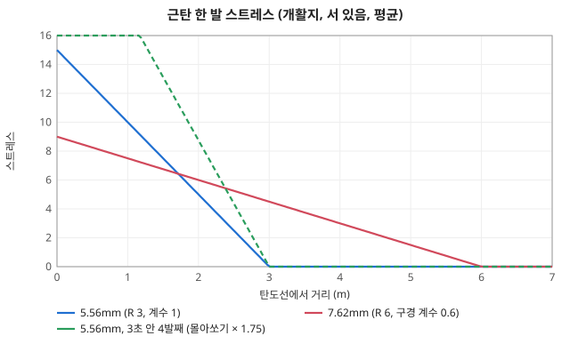
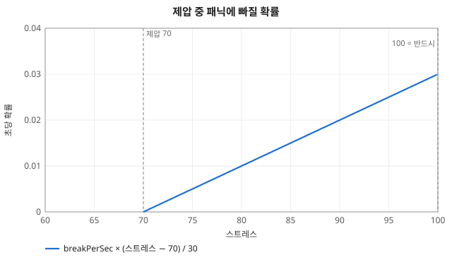
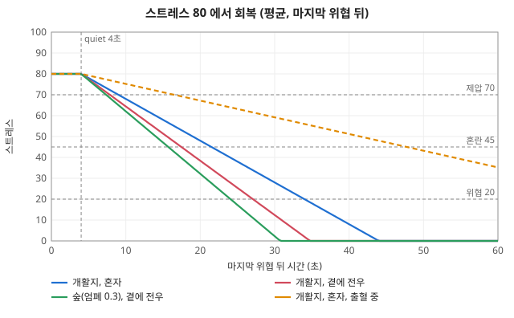
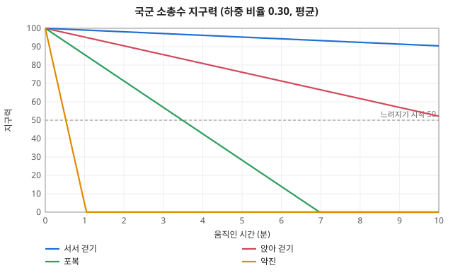
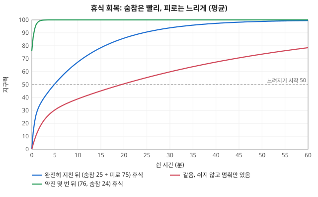
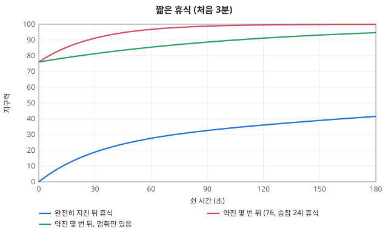
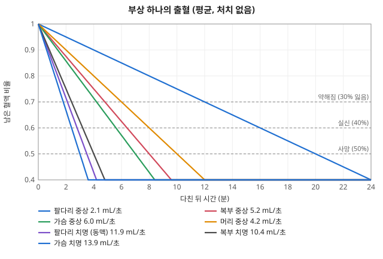

# 늘고 주는 몸 수치 `RATES`

코드: [`packages/sim/src/body/rates.ts`](../../packages/sim/src/body/rates.ts). 시간과 사건에 따라 늘었다 줄었다 하는 병사 수치(스트레스·지구력·혈액)를 모아 둔 곳이다.
늘고 주는 양을 정하는 상수(`RATES`)와 그 변화를 적용하는 함수가 모두 여기 있다. 문턱(어디서부터 제압이고 실신·사망인가)은 따로 둔다: 심리 단계는 [`body/soldier.ts`](../../packages/sim/src/body/soldier.ts) `STRESS`, 부상은 [`body/wound.ts`](../../packages/sim/src/body/wound.ts) `WOUND` ([../objects/soldier.md](../objects/soldier.md)).

## 원칙
- **양은 흔든다**: 사건마다, 틱마다 정한 양에 `vary`(± 비율)를 곱한다. 같은 근탄이라도 매번 받는 양이 다르다.
- **회복은 형편을 따른다**: 시간이 지나면 똑같이 줄지 않는다. 마지막 위협 뒤 얼마나 조용했는지, 엄폐에 있는지, 곁에 전우가 있는지, 피를 흘리는지에 따라 달라진다.
- **단계 전환은 확률이다**: 패닉에 빠지는 것, 패닉에서 벗어나는 것, 맞자마자 쇼크에 빠지는 것은 문턱을 넘는 순간 정해지지 않는다. 초당 확률이나 사건 확률로 굴린다.
- 난수는 모두 시드 RNG(`w.rng`)라 같은 시드와 명령 기록이면 결과도 같다.
- 사격·이동 행동의 흔들림(조준 시간, 걸음, 재장전)은 [`core/vary.ts`](../../packages/sim/src/core/vary.ts) `VARY` 에 있다 ([random/rolls.md](random/rolls.md)). 여기에는 몸 수치만 둔다. 흔드는 식(`vary`)과 난수 순서는 [random/](random/README.md).

## 스트레스 `RATES.stress`

### 늘어남 (사건)
`threat(w, s, base, scale)` = `base × (1 ± vary 0.3) × scale` 만큼 올리고, `threatTick` 을 지금 틱으로 둔다.
`addStress(w, s, n)` 는 흔들지 않고 그대로 올린다 (테스트·드릴용).

| 사건 | 기준 `base` | 계수 `scale` | 어디서 |
|---|---|---|---|
| 근탄 `nearMiss` | 15 | (1 − 거리/제압 반경) × 노출(엄폐 ×(1 − 0.6 × 엄폐), 이동 중 ×1.15) × 몰아쏘기(1 + `volume` 0.25 × 앞선 `volumeWindow` 3초 안 근탄 수, 최대 `volumeMax` 4발) | [`combat/fire.ts`](../../packages/sim/src/combat/fire.ts) 직사 → [`body/rates.ts`](../../packages/sim/src/body/rates.ts) `nearMiss` ([fire.md](fire.md) "근탄") |
| 피격 `hit` | 30 | 1 | [`combat/fire.ts`](../../packages/sim/src/combat/fire.ts) `wound` |
| 폭발 `blast` | 40 | (1 − 거리/제압 반경) × 시선 차폐(막히면 0.15) | [`combat/fire.ts`](../../packages/sim/src/combat/fire.ts) `explode` |
| 전우 피격 `buddyDown` | 15 | `buddyRadius`(15m) 안의 같은 편 (싸울 수 있는) 병사 | [`body/soldier.ts`](../../packages/sim/src/body/soldier.ts) `updateBody`, 무력화·사망하는 틱 |


*근탄 한 발이 올리는 스트레스 (± 30% 흔들림 전, 엄폐 없음)*

### 확률 사건
| 사건 | 확률 | 결과 |
|---|---|---|
| 피격 쇼크 `shock` | 찰과 0.02 · 경상 0.1 · 중상 0.6 · 치명 0.9 | 스트레스 최대, 바로 패닉 (`broken`) |
| 제압 중 패닉 `breakPerSec` | 초당 0.2 × (스트레스 − 70) / 30 | 패닉. 스트레스가 최대(100)에 닿으면 반드시 |
| 패닉 회복 `rallyPerSec` | 스트레스 < `STRESS.rally`(30) 일 때 초당 0.25 | 그 스트레스의 단계로 돌아감 |

초당 확률은 매 틱 `perSecChance(p) = 1 − (1 − p)^DT` 로 바꿔 굴린다 ([README.md](README.md) "공통 규칙").


*제압(70) 을 넘으면 스트레스에 비례해 패닉 확률이 오르고, 100 이면 반드시*

### 줄어듦 (매 틱 `updateStress`)
- 마지막 위협 뒤 `quiet`(4초)가 지나기 전에는 줄지 않는다 (근탄마다 다시 센다. 3초에 1발이면 풀리지 않아 제압이 유지된다).
- 초당 감소 = `decay`(2) × (1 + `cover`(0.5) × 발밑 엄폐) × (`buddyRadius` 안에 싸울 수 있는 전우가 있으면 `buddyNear` 1.3) × (피를 흘리면 `bleeding` 0.4).
- 틱마다 이 값에 ± `decayVary`(50%)를 곱한다.


*마지막 위협 뒤 4초 기다린 다음 형편에 따라 다른 속도로 준다*

## 지구력 `RATES.stamina`
- 움직인 틱: 초당 `drain[자세]` × (1 + 하중 비율 × `LOAD.staminaPerRatio` 2) × (1 ± `vary` 20%). 걸을 때는 서기 0.01, 앉아 0.05, 포복 0.15, 약진은 자세와 상관없이 1.
  쓴 만큼 숨참(`winded`)에 쌓는다 (`windedMax` 25 까지). 결손 = 숨참 + 피로 (나머지).
- 멈춘 틱: 숨참과 피로가 각각 남은 양에 비례해 준다 (지수 감소). 처음 빠르고 끝에 느리다.

```
t   = dt × (휴식이면 1, 아니면 idleCoef 0.25) × (1 ± vary 20%)
숨참 회복 = 숨참 × (1 − e^(−t / windedTau 30초))
피로 회복 = 피로 × (1 − e^(−t / fatigueTau 720초))
```

- 출처: 근육 크레아틴인산 재합성은 두 단계 (빠른 쪽 반감기 20초대, Harris 외 1976 *Pflügers Arch* 367), 운동 뒤 산소 부채는 몇 분 안의 빠른 성분과 오래 가는 느린 성분 (Gaesser & Brooks 1984 *Med Sci Sports Exerc* 16). 시간 상수 30초·12분과 숨참 상한 25 는 **추정**.
- 결과: 완전히 지친 뒤(숨참 25 + 피로 75) 쉬면 2분에 ≈ 36, 32분에 95, 52분에 99. 약진 몇 번(숨참 ≈ 24) 뒤 1분 쉬면 쓴 것의 ≈ 86% 가 돌아온다. 오래 걸어 쌓인 피로만 있으면 (숨참 0) 2분 쉬어도 ≈ 15.
- 문턱(속도가 줄기 시작하는 `tiredAt` 50, 최저 속도 계수)은 [`body/soldier.ts`](../../packages/sim/src/body/soldier.ts) `STAMINA`.


*자세·걸음별 지구력 소모*


*휴식 회복: 숨참은 몇 분에, 피로는 50분쯤 걸려 돌아온다*


*짧은 휴식 (처음 3분): 약진 몇 번 뒤면 1분에 대부분 돌아온다*

## 혈액 `RATES.blood`
- 부상마다 출혈 속도(mL/초)가 붙는다. 다칠 때 표 값 × (1 ± `vary` 40%)로 정한다 (`rollWound`, [`body/wound.ts`](../../packages/sim/src/body/wound.ts)).
- 매 틱 혈액량에서 모든 부상의 출혈 합 × dt 를 뺀다 (`updateBlood`).
- 사람 피는 5L(`WOUND.blood`)이고, 30% 를 잃으면 약해지고 40% 면 실신(무력화), 50% 면 사망한다.

| 부위 \ 정도 | 찰과 | 경상 | 중상 | 치명 |
|---|---|---|---|---|
| 머리 | 0.1 | 0.5 | 4 | 10 (총탄 치명은 즉사) |
| 가슴 | 0.1 | 1 | 6 (≈ 7분에 사망) | 15 (≈ 3분) |
| 복부 | 0.1 | 1 | 5 (≈ 8분) | 12 (≈ 3.5분) |
| 팔다리 | 0.1 | 0.5 | 3 (≈ 14분) | 12 (동맥, ≈ 3.5분) |

- 지금은 출혈을 멈출 방법이 없다. 응급처치(지혈대·압박)는 리더 로직과 함께 넣는다 (사용자 결정).


*부상 하나의 혈액 감소와 약해짐·실신·사망 문턱*

## 매 틱 순서 (`updateBody`, [`body/soldier.ts`](../../packages/sim/src/body/soldier.ts))
출혈 → (무력화면 쓰러짐) → 지구력 → 상태 → (막 쓰러졌으면 전우 피격) → 자세 → 스트레스.

## 상수 — 무엇을 하나

### 스트레스 양 (`RATES.stress`)
| 상수 | 값 | 하는 일 | 키우면 |
|---|---|---|---|
| `vary` | ± 30% | 사건마다 받는 스트레스 양의 흔들림 | 같은 사건도 사람마다 더 다르게 눌림 |
| `nearMiss` | 15 | 탄도선이 바로 곁(거리 0)을 지날 때 받는 양. 제압 반경 끝에서 0 | 근탄이 더 세게 누름 (제압이 빨라짐) |
| `volume` | 0.25 | 몰아쏘기: 앞선 근탄 한 발마다 이번 근탄에 더하는 계수 | 집중 사격이 더 세게 누름 |
| `volumeWindow` | 3초 | 몰아쏘기로 세는 앞선 근탄의 시간 창 | 드문 사격도 몰아쏘기로 침 |
| `volumeMax` | 4발 | 몰아쏘기로 세는 근탄 수 상한 (최대 × 2) | 집중 사격 효과의 천장이 높아짐 |
| `hit` | 30 | 맞았을 때 받는 양 | 맞은 사람이 더 눌림 |
| `blast` | 40 | 폭발 중심에서 받는 양 (제압 반경 끝에서 0) | 유탄이 더 세게 누름 |
| `buddyDown` | 15 | 곁의 전우가 쓰러질 때 받는 양 | 사상자가 주변을 더 흔듦 |
| `buddyRadius` | 15 m | "곁" 의 거리: 전우 피격을 받는 범위이자, 회복을 돕는 전우를 찾는 범위 | 더 멀리 있는 전우도 영향 |
| `shock` | 찰과 0.02 · 경상 0.1 · 중상 0.6 · 치명 0.9 | 맞자마자 바로 패닉에 빠질 확률 (부상 정도별). 가벼운 상처는 대개 스트레스(`hit` 30)만 올린다. **추정값** (#44): 정도별 패닉 비율을 잰 자료를 찾지 못해, Beecher 1946 *Pain in Men Wounded in Battle* (중상자 다수가 전투 직후 통증을 거의 느끼지 않음)·Grossman *On Combat* (교전 중엔 맞은 줄 모르는 일이 흔함) 같은 정성 자료에 맞춰 낮게 잡음 | 맞은 병사가 더 쉽게 무너짐 |
| `breakPerSec` | 0.2 | 제압 중 초당 패닉 확률의 최대 (스트레스 100 바로 아래에서). 70 에서 0 | 제압된 병사가 더 쉽게 무너짐 |
| `rallyPerSec` | 0.25 | 패닉 중 스트레스가 `STRESS.rally` 아래일 때 초당 정신 차릴 확률 | 패닉에서 더 빨리 벗어남 |

### 스트레스 회복 (`RATES.stress`)
| 상수 | 값 | 하는 일 | 키우면 |
|---|---|---|---|
| `quiet` | 4초 | 마지막 위협 뒤 이만큼 조용해야 회복이 시작됨 (근탄마다 다시 셈) | 띄엄띄엄 쏴도 제압이 유지됨 |
| `decay` | 2 /초 | 기준 회복 속도 | 빨리 풀림 |
| `decayVary` | ± 50% | 틱마다 회복량 흔들림 | 회복이 더 들쭉날쭉 |
| `cover` | 0.5 | 발밑 엄폐 1 일 때 회복 계수에 더하는 값 (엄폐 0.3 이면 × 1.15) | 엄폐 속에서 더 빨리 풀림 |
| `buddyNear` | 1.3 | 곁에 싸울 수 있는 전우가 있으면 회복 계수 | 뭉쳐 있으면 더 빨리 풀림 |
| `bleeding` | 0.4 | 피를 흘리고 있으면 회복 계수 | 다친 병사도 덜 늦게 풀림 (1 이면 영향 없음) |

### 문턱 (`STRESS`, `soldier.ts`) — 양이 아니라 단계를 가르는 선
| 상수 | 값 | 하는 일 |
|---|---|---|
| `alert` / `shaken` / `suppressed` / `broken` | 20 / 45 / 70 / 100 | 위협 인지 / 혼란·위축 / 제압 / 반드시 패닉 단계가 시작되는 스트레스 |
| `rally` | 30 | 패닉이 (확률로) 풀릴 수 있는 스트레스 상한 |
| `orderDelay` | 2초 | 혼란·위축 중 명령을 늦게 따르는 시간 |
| `max` | 100 | 스트레스 최대 |

### 지구력 (`RATES.stamina`, `STAMINA`, `LOAD`)
| 상수 | 값 | 하는 일 | 키우면 |
|---|---|---|---|
| `drain.stand` / `crouch` / `prone` | 0.01 / 0.05 / 0.15 /초 | 그 자세로 걸을(길) 때 짐 없는 초당 소모 | 그 자세 이동이 빨리 지침 |
| `drain.rush` | 1 /초 | 약진 중 초당 소모 (자세 무관) | 약진을 짧게만 할 수 있음 |
| `LOAD.staminaPerRatio` | 2 | 하중이 소모를 늘리는 정도: × (1 + 하중 비율 × 이 값) | 짐 진 병사가 더 빨리 지침 |
| `windedMax` | 25 | 숨참(빨리 돌아오는 결손) 상한. 넘게 쓴 것은 피로로 남음 | 오래 뛰어도 짧은 휴식으로 돌아옴 |
| `windedTau` | 30초 | 쉴 때 숨참이 돌아오는 시간 상수 (30초에 63%, 90초에 95%) | 숨 고르기가 느려짐 |
| `fatigueTau` | 720초 | 쉴 때 피로가 돌아오는 시간 상수 (0 → 95 ≈ 32분, → 99 ≈ 52분) | 완전 회복이 더 오래 걸림 |
| `idleCoef` | 0.25 | 쉬지 않고 멈춰만 있을 때 (조준·사격·대기) 회복 계수 (휴식 1) | 휴식 없이도 회복 |
| `vary` | ± 20% | 틱마다 소모·회복 흔들림 | 더 들쭉날쭉 |
| `STAMINA.max` | 100 | 지구력 최대·시작값 | — |
| `STAMINA.tiredAt` / `minSpeed` | 50 / 0.5 | 속도가 줄기 시작하는 지구력 / 0 일 때 속도 계수 ([movement.md](movement.md)) | — |

### 혈액 (`RATES.blood`, `WOUND`)
| 상수 | 값 | 하는 일 | 키우면 |
|---|---|---|---|
| `bleed[부위][정도]` | 위 표 (mL/초) | 부상 하나의 출혈 속도 | 그 부상이 빨리 죽음으로 감 |
| `vary` | ± 40% | 부상마다 출혈 흔들림 (다칠 때 한 번) | 같은 부상도 더 다르게 흐름 |
| `WOUND.blood` | 5000 mL | 몸 전체 혈액량 (시작값) | 모든 출혈이 더 오래 버팀 |
| `WOUND.weakLoss` / `faintLoss` / `deathLoss` | 0.3 / 0.4 / 0.5 | 잃은 피 비율이 이를 넘으면 약해짐 (느려지고 못 쏨) / 실신(무력화) / 사망 | 같은 출혈에도 더 오래 버팀 |

## 계산 예

| 상황 | 계산 | 결과 |
|---|---|---|
| 5.56mm 근탄이 1m 옆을 지남, 개활지에 서 있음, 앞선 3초 안 근탄 없음 | 15 × (1 − 1/3) × 1 | 약 10 (7 ~ 13) |
| 같은 자리에 3초 안 4발째 | 15 × (1 + 0.25 × 3) × 0.67 | 약 17.5 |
| 같은 근탄, 숲(엄폐 0.3) 에 엎드려 있음 | 10 × (1 − 0.6 × 0.3) | 약 8.2 |
| 스트레스 85 로 제압 중 | 패닉 확률 0.2 × (85 − 70) / 30 | 초당 0.1 (틱당 0.025) |
| 숲에서 쉼, 곁에 전우, 출혈 없음 | 2 × (1 + 0.5 × 0.3) × 1.3 | 초당 약 3 감소 (±50%) |
| 국군 소총수 (하중 비율 0.30) 서서 걷기 | 0.01 × (1 + 0.30 × 2) | 초당 0.016 → 50 까지 약 52분 |
| 같은 병사 포복 / 약진 | 0.15 × 1.6 / 1 × 1.6 | 초당 0.24 (약 3.5분) / 1.6 (약 31초) |
| 다리 중상 (3 mL/초) 하나 | 5000 × 0.3 ÷ 3 / × 0.4 ÷ 3 / × 0.5 ÷ 3 | 약 8분에 약해짐, 11분에 실신, 14분에 사망 (출혈 ± 40%) |

### 제압 수치 근거 (#17)
목표: 1m 안 초당 1발 → 몇 초(≤6초) 만에 제압, 3초에 1발 → 제압 유지, 3m 안 3초에 2발 → 제압, 드문 먼 근탄 → 제압 안 됨 ([`body/soldier.test.ts`](../../packages/sim/src/body/soldier.test.ts) "제압 (근탄)", 드릴 `supp-*`).
출처: Leo Murray *War Games* (Morray 로 인용됨, https://defense-and-freedom.blogspot.com/2022/11/suppression-by-infantry-weapons.html), DTIC AD519874 (빗나간 거리에 선형, 탄량·소리에 비례), ARI TR-79-A19 (빗나간 거리·구경·발사 속도). 구경별 반경(5.56mm 3m, 7.62mm 4~6m)은 출처 미확인 현장 시험 인용이라 실마리로만 쓴다.
