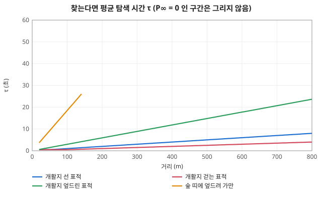

# 시야·탐지 계산

코드: [`perception/vision.ts`](../../packages/sim/src/perception/vision.ts) (`VISION`), [`perception/scan.ts`](../../packages/sim/src/perception/scan.ts) (`SCAN`, 경계 시선), [`terrain/terrain.ts`](../../packages/sim/src/terrain/terrain.ts) (`rimDist`·`rimExposure`·`aimZ`, `RIM`).
아는 적 `Contact` 필드는 [../objects/world.md](../objects/world.md), 경계 필드(`look` 등)는 [../objects/soldier.md](../objects/soldier.md) "경계 (시선)".

## 1. 시선 투과율 `lineOfSight` (0 = 막힘 ~ 1 = 트임)

- 관측자 눈 = 발 딛은 높이 + 몸 높이 × 0.93 (`eyeRatio`). 표적 = 몸 높이 × 0.7 (`aimRatio`, 둔덕 위로 드러난 몸 가운데보다 낮지 않게 `aimZ`).
- 두 점 사이 직선을 관측자 1.5m 뒤부터 표적 1.5m 앞까지 (`standoff`) 1m 마다 (`step`) 본다. 둘 사이가 3m 이하면 1.
  - 그 점 높이 ≤ 지면 → 0 (능선·둔덕에 걸림).
  - 지물 높이 아래를 지나면 밀도를 더한다. 투과율 = `exp(−Σ 밀도 × 1m)`. 0.01 (`cutoff`) 아래가 되면 0.
- 예: 숲(0.08/m) 10m → 0.45, 20m → 0.20, 24m 넘으면 계속 보기 문턱(0.15) 아래. 생울타리(0.5/m) 2m → 0.37. 건물·담(10/m) 1m → 0.


*지물 속을 지나는 시선 길이에 따른 투과율. 점선 아래로 내려가면 보던 적을 놓친다*

### 도랑·참호 (`depth`)
- 표적이 파인 칸에 있으면 관측자 쪽으로 3m(`RIM.reach`) 안, 0.25m 간격으로 처음 나오는 안 파인 땅 = 둔덕 끝 (`rimDist`). 없으면 (참호를 따라 보면) 가리지 않는다.
- 드러난 비율 `rimExposure` = 둔덕 끝을 스치는 선(관측자 눈 → 둔덕 끝 지면)이 표적 자리에서 닿는 높이보다 위에 있는 몸 비율. 투과율에 곱한다.
- 관측자 쪽에서 둔덕 끝까지의 시선이 표적 정수리 이하면 0 (관측자가 파인 칸에 있어도 눈이 둔덕 너머로 나와야 본다).
- 예: 평지 200m 에서 서서 보면 참호(1.2m) 속 선 사람(1.75m)은 ≈ 0.55 / 1.75 = 0.31 만 보이고, 앉거나 엎드리면 0.

## 2. 시야각 계수 `fovFactor`

눈 방향(`look`)과 표적 방향 사이 각 a:
- a ≤ 60° (`fovFull` 120 의 절반) → 1
- 60° < a ≤ 100° (`fovMax` 200 의 절반) → 1 에서 0.25 (`peripheral`)까지 선형
- 그 밖 → 0 (못 봄). 거리 800m (`range`) 넘어도 0.


*눈 방향에서 60° 까지 온전히, 100° 까지 0.25 로 줄고, 그 뒤는 못 본다*

## 3. 처음 보는 적의 발견: 임계 P∞ + 탐색 시간 τ (`detectFactors`·`searchStep`, #33)

예전엔 조건이 나쁘더라도 p > 0 이면 매 틱 굴림이 쌓여 오래 보면 언제든 찾았다. 지금은 두 단계다 (Friedman·Mark·Skirlo 2019 식 `P(t) = P∞ · (1 − e^(−t/τ))` 의 구조, 근거 [../research/33-detection.md](../research/33-detection.md)).

```
발견 조건 x = 거리 × 크기 × 투과 × (1 − 은폐) × 움직임 × 사격 × 가만함 × 관측자 × 심리
  거리 = baseRange ÷ 거리(m, 최소 1)      크기 = (자세별 몸 높이 ÷ 선 키)^sizeExp
끝내 찾을 확률  P∞ = x^E / (1 + x^E)   (E = curveExp. P∞ < minDetect 이면 0 = 끝내 못 찾음)
찾는다면 평균 탐색 시간  τ = max(minSearchTime, baseSearchTime ÷ x)   (초)
```

| 항 | 식 | 상수 |
|---|---|---|
| 거리 | `baseRange / max(거리, 1)` — x = 1 이 되는 거리가 기준 발견 거리 (트인 곳에 가만히 선 사람, 관측자 평상) | `baseRange` 600 m (추정) |
| 크기 | `(몸 높이 / 선 키)^0.5` — 앉음 0.77, 엎드림 0.45 (추정) | `sizeExp` 0.5 |
| 투과·은폐 | 드러난 정도 `shown = 투과율 × (1 − 은폐)`, 표적 칸 `concealment`, 표적이 움직이면 은폐 × 0.5 | `movingConcealment` |
| 움직임 | 표적이 `moving` 이면 2 | `moving` |
| 사격 | 쏘는 중이거나 쏜 지 3초 안(`cueWindow`)이면 3. 창이 끝나면 1 로 되돌아가 계획이 새로 굴러진다 | `cue`, `cueWindow` |
| 가만함 | 관측자가 걷고 표적이 움직이지도 쏘지도 않으면 `shown^((3 − 1) × far)`, far = 거리 15m → 0, 45m → 1 선형. 그 밖은 1 | `stillPower` 3, `stillNear` 15, `stillFar` 45 |
| 관측자 걸음·휴식 | 관측자가 `moving` 이면 0.5, 쉬는 중(`resting`)이면 0.5, 감시·교전은 1 | `observerMoving`, `restObserve` |
| 심리 | 평상 1, 위협 1.2, 혼란 0.6, 제압 0.3, 패닉 0 (관측자에서 빠짐) | `STRESS.observe` |
| 곡선 | P∞ 꼴 (TTP 꼴, 지수는 추정) | `curveExp` 2 |
| 임계 | P∞ 가 이 아래면 0 (추정) | `minDetect` 0.05 |
| 탐색 시간 | τ = baseSearchTime ÷ x, 하한 minSearchTime (추정) | `baseSearchTime` 6 초, `minSearchTime` 0.5 초 |

시야각 계수 `fov`(2절)는 x 에 들어가지 않는다. 눈이 표적 쪽을 향해 시야각 안에 있는 동안만 탐색 시간이 `fov` 배 빠르게 흐른다 (시선이 딴 데를 보면 멈추고, 돌아오면 이어짐).

### 탐색 계획 (관측자 한 명 × 표적 한 명, `World.search`)

- 아직 못 본 적이 시선(투과 > 0)에 들어 있으면 계획 `{lx, left}` 를 가진다. `lx = log2(x)`, `left` = 시야 안에서 더 지나야 할 초 (`null` = 끝내 못 찾음).
- **굴리는 때**: 계획이 없을 때, 그리고 x 가 계획을 굴린 때보다 `rerollOctaves` 0.5 옥타브(약 ×1.41) 이상 바뀌었을 때. 그때 P∞ 로 "끝내 찾는가"를 한 번, 찾는다면 `left` 를 평균 τ 인 지수 분포(`−τ ln(1 − u)`)에서 한 번 뽑는다.
- 매 틱 시야 안이면 `left −= DT × fov`; 0 이하가 되면 발견. **못 찾는 계획(`null`)은 조건이 그대로면 아무리 오래 봐도 못 찾는다.** 표적이 움직이거나 쏘거나 일어서면(x 가 옥타브 반 넘게 오름) 다시 굴려 가능해지고, 창이 끝나 x 가 내려가면 다시 굴려 되돌아간다.
- 발견되면, 시선이 끊기면(투과 0), 관측자가 못 보는 상태면 계획을 버린다. 이미 보던 적이 시선 투과 ≥ 0.15(`track`)로 남아 있는 동안은 굴리지 않는다.
- 관측자가 여럿이면 관측자마다 독립 계획이고 가장 먼저 `left` 가 닿는 사람이 찾는다. 진영 안 공유는 시야 공유가 아니라 육성 보고(아래 "접촉 보고", #45).
- 난수는 전용 `World.searchRng` 로만 굴린다 (사격 난수 흐름을 흔들지 않음). 굴림 순서: [random/rolls.md](random/rolls.md) "탐지".


*거리 계수: 600m 에서 1, 가까울수록 반비례로 커진다*


*끝내 찾을 확률 P∞. minDetect 아래로 내려가면 0 (끝내 못 찾음)*


*찾는다면 평균 탐색 시간 τ*


*걷는 관측자에게 가만히 숨은 표적이 얼마나 드러나는가 (15m 안은 그대로, 45m 부터 세제곱)*

### 값의 근거 (모두 `추정`, 사람 표적 N50·τ 원문은 공백)

- 구조(P∞·τ, 조건이 바뀌면 다시 계산, τ 는 거리·잡음이 늘면 커지고 P∞ 는 작아짐): Friedman 2019 (확인).
- 곡선의 출발 N50: Johnson 탐지 1.0 주기(2차), 은폐 범위 TTP 표 6.2 의 0.75~1.7 (확인, 열영상·차량). 사람 표적 N50·맨눈 τ 상수는 못 구해 `baseRange`·`baseSearchTime`·`curveExp`·`minDetect`·`sizeExp` 모두 추정이다 (이슈 #33 결정 2026-10-16: 목표 시간은 추정으로 두고 현실화는 별개 이슈).
- 추정을 맞춘 목표(시뮬 값, 200 시드): 개활지 400m 걷는 표적 중앙값 ≈ 2초(찾는 시드 약 94%), 숲 띠에 엎드려 가만한 400m 표적 10분 0%.

## 4. 계속 보기·잊기 (`updateVision`)

- 지난 틱에 보이던 적은 관측자 누구든 투과율(시야각 안) ≥ 0.15 (`track`) 이면 계속 보인다 (굴리지 않음).
- 놓치면 다시 처음 보는 적처럼 굴린다. 마지막으로 본 뒤 30초(`memory` 120틱)가 지나면 잊는다.

## 5. 경계 시선 ([`perception/scan.ts`](../../packages/sim/src/perception/scan.ts))

탐지의 시야각은 `look` 으로 잰다. 시선은 매 틱 행동 뒤, 탐지 전에 움직인다.
- 고개: 매 틱 남은 각의 50% (`ease`), 최고 300°/초 (`turnMax`, 한 틱 75°). 0.5° 안이면 붙는다. 몸 정면 ± 90° (`neck`) 밖으로는 못 돈다.
- 몸: 위협 쪽이 고개 한계 밖이면 `bodyAim` 을 잡고, 고개가 한계에서 15° (`bodyLead`) 안쪽(= 75°)까지 돌면 몸이 돌기 시작한다. 서기·앉기 240°/초 (한 틱 60°), 엎드려 45°/초 (한 틱 11.25°). 걷는 중에는 몸이 진행 방향에 묶여 몸 돌리기를 버린다.
- 볼 곳 고르기, 돌아보기의 난수와 분포는 [random/rolls.md](random/rolls.md) "경계 시선".

## 계산 예 (관측자 평상·서서 멈춤·정면, 개활지, 표적 선 자세: x → P∞ / τ)

| 표적 | 100m | 200m | 400m | 600m |
|---|---|---|---|---|
| 서 있음 | 6.0 → 0.97 / 1.0초 | 3.0 → 0.90 / 2.0초 | 1.5 → 0.69 / 4.0초 | 1.0 → 0.50 / 6.0초 |
| 걷기 (움직임 ×2) | 12 → 0.99 / 0.5초 | 6.0 → 0.97 / 1.0초 | 3.0 → 0.90 / 2.0초 | 2.0 → 0.80 / 3.0초 |

| 400m 에 가만히 엎드림 (크기 0.45) | 계산 | x → P∞ |
|---|---|---|
| 개활지 | 1.5 × 0.45 | 0.68 → 0.32 (τ ≈ 8.9초) |
| 숲 띠 8m (투과 ≈ 0.4 × (1 − 은폐 0.6) → shown 0.16) | 1.5 × 0.45 × 0.16 | 0.11 → 0.01 < minDetect 0.05 → **0 (끝내 못 찾음)** |

시뮬 200 시드 (관측자 정면, 가만히 보는 표적, `vision.test.ts`·드릴 `detect-*`): 개활지 400m 걷는 표적 중앙값 2초·94% 찾음, 숲 띠 엎드림 가만 400m 10분 0%. 숲 띠 엎드림 가만이 100m 면 55% (중앙값 7초), 50m 면 89% (중앙값 3초).

## 상수 — 무엇을 하나

### 시선 (`VISION`, `RIM`)
| 상수 | 값 | 하는 일 | 키우면 |
|---|---|---|---|
| `VISION.eyeRatio` | 0.93 | 눈높이 = 자세별 몸 높이 × 이 값 | 눈이 높아져 둔덕·낮은 지물 너머를 봄 |
| `VISION.aimRatio` | 0.7 | 표적에서 시선이 닿는 높이 = 표적 몸 높이 × 이 값 (상체) | 표적의 더 윗부분을 보면 됨 (낮은 지물에 덜 가림) |
| `VISION.step` | 1 m | 시선을 따라 지면·지물을 검사하는 간격 | 검사가 성겨짐 |
| `VISION.standoff` | 1.5 m | 관측자·표적 바로 곁은 시선 검사에서 뺌 (숲 안에서도 밖은 봄, 덤불 속 표적도 자기 덤불엔 안 가림) | 지물 가장자리에 붙은 사람이 더 잘 보고 보임 |
| `VISION.cutoff` | 0.01 | 투과율이 이 아래면 0 으로 끊음 (계산 줄이기) | 옅은 시선을 더 일찍 버림 |
| `VISION.range` | 800 m | 이 너머는 보지 못함 | 더 먼 적도 볼 수 있음 |
| `RIM.reach` | 3 m | 도랑·참호 속 사람에게서 둔덕 끝을 찾는 거리. 그 안에 안 파인 땅이 없으면 (참호를 따라 보면) 가리지 않음 | 더 넓은 참호도 둔덕이 가림 |
| `RIM.step` | 0.25 m | 둔덕 끝을 찾는 간격 | 찾기가 성겨짐 |
| 지형 `density` / `height` | 칸마다 ([../objects/terrain.md](../objects/terrain.md)) | 지물이 1m 당 시선을 줄이는 정도 / 시선을 가리는 높이 | 그 지물이 더 많이·높이 가림 |

### 발견 (`VISION`, `STRESS.observe`)
| 상수 | 값 | 하는 일 | 키우면 |
|---|---|---|---|
| `VISION.baseRange` | 600 m | x = 1 이 되는 기준 발견 거리 (트인 곳에 가만히 선 사람). 추정 | 먼 적도 더 확실하고 빨리 찾음 |
| `VISION.curveExp` | 2 | P∞ = x^E / (1 + x^E) 의 지수 E (클수록 임계 근처가 가파름). 추정 | 임계 위·아래가 더 갈림 |
| `VISION.minDetect` | 0.05 | P∞ 가 이 아래면 0 (끝내 못 찾음). 추정 | 더 많은 조건이 "끝내 못 찾음" |
| `VISION.baseSearchTime` | 6 초 | 평균 탐색 시간 τ = 이 값 ÷ x. 추정 | 모든 탐색이 느려짐 |
| `VISION.minSearchTime` | 0.5 초 | τ 하한 | 아주 쉬운 표적도 이만큼은 걸림 |
| `VISION.rerollOctaves` | 0.5 | x 가 이만큼(log2) 바뀌어야 탐색 계획을 다시 굴림 | 조건이 크게 바뀌어야 다시 굴림 (경계에서 덜 흔들림) |
| `VISION.cue` / `cueWindow` | 3 / 3초 | 쏜 표적 발견 계수와 쏜 뒤 눈에 띄는 시간 (일시 단서). 추정 | 사격이 더 오래·크게 드러남 |
| `VISION.sizeExp` | 0.5 | 크기 계수 = (자세별 몸 높이 ÷ 선 키)^이 값. 추정 | 엎드림·앉음이 더 작게 보임 |
| `VISION.fovFull` | 120° | 눈 방향 기준 온전히 보는 시야각 (양쪽 60°) | 옆의 적도 정면만큼 잘 봄 |
| `VISION.fovMax` | 200° | 주변 시야 끝 (양쪽 100°). 그 밖은 0 | 더 뒤쪽까지 어렴풋이 봄 |
| `VISION.peripheral` | 0.25 | 주변 시야 끝에서의 발견 계수 (fovFull 끝 1 → 여기까지 선형) | 곁눈으로 더 잘 봄 |
| `VISION.moving` | 2 | 움직이는 표적의 발견 조건 계수 | 움직이는 적이 더 잘 보임 |
| `VISION.movingConcealment` | 0.5 | 움직이는 표적은 칸 은폐가 이 계수로 줄어듦 | 움직여도 은폐가 덜 깨짐 |
| `VISION.observerMoving` | 0.5 | 걷는 관측자의 발견 계수 (발밑·진행 방향에 눈이 감) | 걸으면서도 잘 봄 |
| `VISION.restObserve` | 0.5 | 쉬는 관측자의 발견 계수 (#25, 느슨하게 둘러봄. 추정) | 쉬면서도 잘 봄 |
| `VISION.stillPower` | 3 | 걷는 관측자가 가만히 숨은 표적을 볼 때 드러난 정도를 거듭제곱하는 지수 (일부만 보이는 형체가 배경에 묻힘) | 매복이 더 잘 숨음 |
| `VISION.stillNear` / `stillFar` | 15 / 45 m | 이 거리 사이에서 stillPower 효과가 0 → 다 쓰임으로 커짐 (가까우면 묻히지 않음) | 매복이 숨는 거리가 멀어짐 / 효과가 천천히 커짐 |
| `VISION.track` | 0.15 | 이미 보던 적을 굴림 없이 계속 보는 데 필요한 시선 투과율 | 지물 뒤로 들어간 적을 더 빨리 놓침 |
| `VISION.memory` | 30초 | 놓친 적의 마지막 위치를 기억하는 시간 | 더 오래 기억 (화면에 흐린 표시) |
| `STRESS.observe` | 평 1 · 위협 1.2 · 혼란 0.6 · 제압 0.3 · 패닉 0 | 관측자 심리 단계별 발견 계수 (경계하면 잘 보고, 눌리면 못 봄) | 그 단계 병사가 더 잘 봄 |

### 경계 시선 (`SCAN`)
| 상수 | 값 | 하는 일 | 키우면 |
|---|---|---|---|
| `SCAN.dwell` / `dwellVary` | 1.5초 / ± 60% | 한 곳을 보고 있는 시간과 그 흔들림 | 눈을 덜 자주 옮김 |
| `SCAN.restDwellCoef` | 2 | 쉬는 병사의 보는 시간 계수 (#25) | 쉴 때 더 천천히 둘러봄 |
| `SCAN.sector` | 50° | 경계 구역 반폭. 구역 중심 ± 이 안을 훑음 | 맡은 구역이 넓어짐 (한 곳을 덜 자주 봄) |
| `SCAN.step` | 35° | 눈을 한 번 옮기는 최대 각 (지금 자리에서 이웃한 곳으로) | 구역 안을 크게 건너뛰며 훑음 |
| `SCAN.flank` | 45° | 가운데 분대원이 맡는 좌·우전방 구역 중심 (정면에서) | 옆을 더 많이 봄 |
| `SCAN.rearShare` | 0.4 | 맨 뒤 분대원이 눈을 옮길 때 뒤를 볼 확률 (나머지는 앞) | 후방을 더 자주 봄 |
| `SCAN.threat` / `threatSpread` | 0.85 / ± 15° | 아는 적이 있을 때 그쪽을 볼 확률과 흔들림 | 적에게 더 붙어 봄 (옆·뒤를 덜 봄) |
| `SCAN.ease` | 0.5 | 고개가 매 틱 남은 각의 이 비율만큼 돎 (멀면 빠르게, 가까우면 느리게) | 고개가 빨리 따라감 |
| `SCAN.turnMax` | 300°/초 | 고개 돌리는 최고 속도 | 큰 각도도 빨리 돎 |
| `SCAN.neck` | 90° | 고개가 몸 정면에서 돌 수 있는 한계 | 몸을 안 돌리고 더 뒤까지 봄 |
| `SCAN.bodyLead` | 15° | 고개가 한계에서 이만큼 안쪽까지 돌아야 몸이 돌기 시작 | 몸이 더 일찍 돌기 시작 |
| `SCAN.bodyTurn.up` / `prone` | 240 / 45 °/초 | 몸 돌리는 최고 속도 (서기·앉기 / 엎드려) | 몸이 빨리 돎 |
| `SCAN.reaction` | 0.3 ~ 1초 | 직사 탄이 스친 뒤 돌아보기까지 | 돌아보기가 늦음 |
| `SCAN.heardError` | 25° | 총소리로 어림한 쏜 쪽 방향의 어긋남 (표준편차) | 엉뚱한 쪽을 돌아봄 |
| `SCAN.fireDwell` | 3초 | 돌아본 쪽을 보고 있는 시간 | 쏜 쪽을 더 오래 봄 |
| `SCAN.hearFarErrorCoef` | 2 | 들은 소리 쪽 방향 어긋남 계수: `heardError` × (1 + 이 값 × (1 − 소리 크기)). 들리는 거리 끝에서 × 3 (#35) | 먼 소리 쪽을 더 엉뚱하게 봄 |

## 접촉 보고 (#45, `comms.ts`)

병사마다 아는 적(`World.known`)이 따로 있다. 직접 본 병사가 외치면 목소리가 닿는 아군이 지연 뒤에 알게 되고, 그 아군이 다시 외쳐 퍼진다. 보고로 받은 접촉은 `told`(직접 본 것이 아님, `visible` 거짓, 위치 오차). 기록은 진영 합친 그림 `World.contacts` 에도 모이지만 표시·요약용이다. 무전기·워키토키는 아직 없다 (#76).

| 항목 | 식·값 | 상수 |
|---|---|---|
| 알아들은 비율 | 거리 0 → 1, 30 m → 0.95, 60 m → 0.85, 90 m → 0.75 직선 보간. 90 m 넘으면 15 m 마다 0.1 씩 줄어 0 에서 멈춤 | `VOICE.recognition`, `tailDrop`, `tailStep` |
| 소음 | 보내는 쪽이나 받는 쪽이 마지막 총소리를 들은 지 10초 안이면 목소리는 10 m 안에서만 닿는다 (사용자 지정, 근거 자료 없음) | `noiseRange`, `noiseHold` |
| 닿는가 | 비율 ≥ 0.5 → 조용할 때 약 127 m | `minRecognition` |
| 보고 시간 | 2초 × (1 + 0.5 × 스트레스 / 100) | `baseDelay`, `stressDelayCoef` |
| 위치 오차 | 보고 한 번마다 반지름 8 m 원 안 균일. 받은 병사가 다시 외치면 또 더해짐 | `posError` |
| 다시 알림 | 직접 보는 동안 4초마다 현재 위치를 다시 외침 | `reportEvery` |
| 전달 한도 | 4단계 | `maxHops` |

- 보내는 병사: 처음 보게 된 때, 그리고 직접 보는 동안 `reportEvery` 마다. 받는 쪽은 같은 진영·무력화 아님·이 접촉에 대해 더 새로운 정보를 아직 갖지 않은 병사.
- 받은 병사는 접촉을 얻고 그 단계 +1 로 다시 외친다. 지시·무전 지연은 #59.
- 수치 출처: `docs/research/45-59-comms.md` §2(인식률 3점, `2차`), §6(나머지 `추정`).
