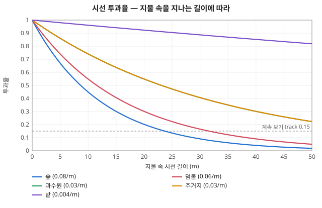
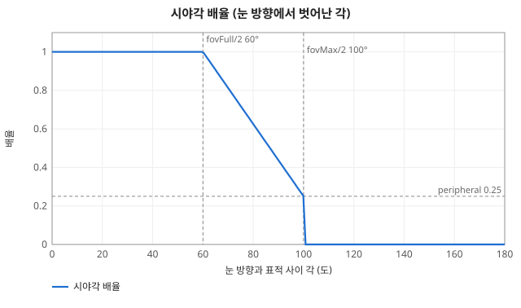
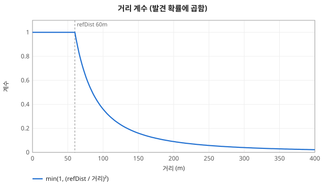
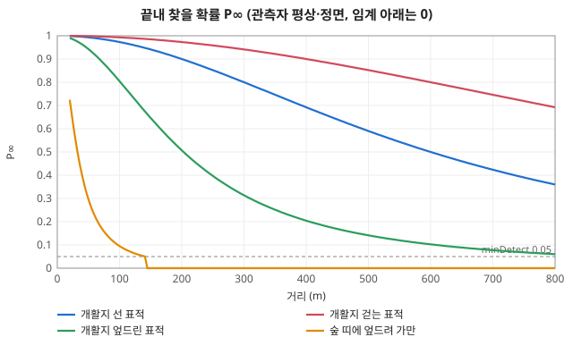
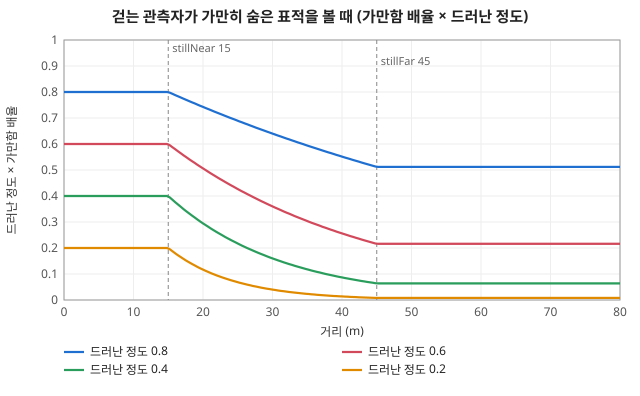

# 시야·탐지 계산

코드: [`perception/vision.ts`](../../packages/sim/src/perception/vision.ts) (`VISION`), [`perception/scan.ts`](../../packages/sim/src/perception/scan.ts) (`SCAN`, 경계 시선), [`terrain/terrain.ts`](../../packages/sim/src/terrain/terrain.ts) (`rimDist`·`rimExposure`·`aimZ`, `RIM`).
아는 적 `Contact` 필드는 [../objects/world.md](../objects/world.md), 경계 필드(`look` 등)는 [../objects/soldier.md](../objects/soldier.md) "경계 (시선)".

## 1. 시선 투과율 `lineOfSight` (0 = 막힘 ~ 1 = 트임)

- 관측자 눈 = 발 딛은 높이 + 몸 높이 × 0.93 (`eyeRatio`). 표적 = 몸 높이 × 0.7 (`aimRatio`, 둔덕 위로 드러난 몸 가운데보다 낮지 않게 `aimZ`).
- 두 점 사이 직선을 관측자 1.5m 뒤부터 표적 1.5m 앞까지 (`standoff`) 1m 마다 (`step`) 본다. 둘 사이가 3m 이하면 1.
  - 그 점 높이 ≤ 지면 → 0 (능선·둔덕에 걸림).
  - 지물 높이 아래를 지나면 밀도를 더한다. 투과율 = `exp(−Σ 밀도 × 1m)`. 0.01 (`cutoff`) 아래가 되면 0.
- 예: 숲(0.08/m) 10m → 0.45, 20m → 0.20, 24m 넘으면 계속 보기 문턱(0.15) 아래. 생울타리(0.5/m) 2m → 0.37. 건물·담(10/m) 1m → 0.


*지물 속을 지나는 시선 길이에 따른 투과율. 점선 아래로 내려가면 보던 적을 놓친다*

### 도랑·참호 (`depth`)
- 표적이 파인 칸에 있으면 관측자 쪽으로 3m(`RIM.reach`) 안, 0.25m 간격으로 처음 나오는 안 파인 땅 = 둔덕 끝 (`rimDist`). 없으면 (참호를 따라 보면) 가리지 않는다.
- 드러난 비율 `rimExposure` = 둔덕 끝을 스치는 선(관측자 눈 → 둔덕 끝 지면)이 표적 자리에서 닿는 높이보다 위에 있는 몸 비율. 투과율에 곱한다.
- 관측자 쪽에서 둔덕 끝까지의 시선이 표적 정수리 이하면 0 (관측자가 파인 칸에 있어도 눈이 둔덕 너머로 나와야 본다).
- 예: 평지 200m 에서 서서 보면 참호(1.2m) 속 선 사람(1.75m)은 ≈ 0.55 / 1.75 = 0.31 만 보이고, 앉거나 엎드리면 0.

## 2. 시야각 계수 `fovFactor`

눈 방향(`look`)과 표적 방향 사이 각 a:
- a ≤ 60° (`fovFull` 120 의 절반) → 1
- 60° < a ≤ 100° (`fovMax` 200 의 절반) → 1 에서 0.25 (`peripheral`)까지 선형
- 그 밖 → 0 (못 봄). 거리 800m (`range`) 넘어도 0.


*눈 방향에서 60° 까지 온전히, 100° 까지 0.25 로 줄고, 그 뒤는 못 본다*

## 3. 처음 보는 적의 발견 확률 `detectFactors` (탐지 주기 1초마다 한 번)

```
드러난 정도 shown = 투과율 × (1 − 은폐)
확률 = min(0.95, 기준 0.36 × 거리 × 시야각 × shown × 움직임 × 가만함 × 관측자 걸음 × 심리)
```

| 항 | 식 | 상수 |
|---|---|---|
| 기준 발견 확률 | 0.36 (0.5초에 0.2 를 두 번 굴린 값 1 − 0.8²) | `baseChance` |
| 거리 | `min(1, (60 / 거리)²)` — 60m 안 개활지에 선 사람은 탐지마다 36% (평균 ≈ 2.8초) | `refDist` 60 |
| 은폐 | 표적 칸 `concealment`, 표적이 움직이면 × 0.5 | `movingConcealment` |
| 움직임 | 표적이 `moving` 이면 2 | `moving` |
| 가만함 | 관측자가 걷고 표적이 움직이지도 쏘지도 않으면 `shown^((3 − 1) × far)`, far = 거리 15m → 0, 45m → 1 선형. 그 밖은 1 | `stillPower` 3, `stillNear` 15, `stillFar` 45 |
| 관측자 걸음 | 관측자가 `moving` 이면 0.5 | `observerMoving` |
| 심리 | 평상 1, 위협 1.2, 혼란 0.6, 제압 0.3, 패닉 0 (관측자에서 빠짐) | `STRESS.observe` |

- 관측자 = 무력화·사망·패닉이 아닌 그 진영 병사. id 순으로 한 명씩 굴려 처음 성공하면 발견 ([random/rolls.md](random/rolls.md) "탐지"). 진영 안에서는 바로 공유.
- 관측자 n 명이 같은 확률 p 면 한 주기에 발견할 확률 `1 − (1 − p)^n`, 평균 걸리는 시간 ≈ 1 / 그 값 (초).


*거리 계수: 60m 까지 1, 그 뒤 거리² 에 반비례*


*개활지 발견 확률 (실선 관측자 1명, 점선 분대 8명)*


*걷는 관측자에게 가만히 숨은 표적이 얼마나 드러나는가 (15m 안은 그대로, 45m 부터 세제곱)*

## 4. 계속 보기·잊기 (`updateVision`)

- 지난 주기에 보이던 적은 관측자 누구든 투과율(시야각 안) ≥ 0.15 (`track`) 이면 계속 보인다 (굴리지 않음).
- 놓치면 다시 처음 보는 적처럼 굴린다. 마지막으로 본 뒤 30초(`memory` 120틱)가 지나면 잊는다.

## 5. 경계 시선 ([`perception/scan.ts`](../../packages/sim/src/perception/scan.ts))

탐지의 시야각은 `look` 으로 잰다. 시선은 매 틱 행동 뒤, 탐지 전에 움직인다.
- 고개: 매 틱 남은 각의 50% (`ease`), 최고 300°/초 (`turnMax`, 한 틱 75°). 0.5° 안이면 붙는다. 몸 정면 ± 90° (`neck`) 밖으로는 못 돈다.
- 몸: 위협 쪽이 고개 한계 밖이면 `bodyAim` 을 잡고, 고개가 한계에서 15° (`bodyLead`) 안쪽(= 75°)까지 돌면 몸이 돌기 시작한다. 서기·앉기 240°/초 (한 틱 60°), 엎드려 45°/초 (한 틱 11.25°). 걷는 중에는 몸이 진행 방향에 묶여 몸 돌리기를 버린다.
- 볼 곳 고르기, 돌아보기의 난수와 분포는 [random/rolls.md](random/rolls.md) "경계 시선".

## 계산 예 (관측자 평상·서서 멈춤·정면, 개활지)

| 표적 | 100m | 200m | 300m |
|---|---|---|---|
| 서 있음 | 0.13 (≈ 8초) | 0.032 (≈ 31초) | 0.014 (≈ 69초) |
| 걷기 | 0.26 (≈ 4초) | 0.065 (≈ 15초) | 0.029 (≈ 35초) |
| 분대 8명이 함께 (걷는 표적) | 0.91 (≈ 1.1초) | 0.41 (≈ 2.4초) | 0.21 (≈ 4.8초) |

| 매복 (관측자가 걸음) | 계산 | 확률 |
|---|---|---|
| 숲 가장자리(은폐 0.6)에 가만히 엎드린 적, 30m | 0.36 × 1 × 0.4 × 0.4^(2 × 0.5) × 0.5 | 0.029 |
| 같음, 50m | 0.36 × 1 × 0.4 × 0.4² × 0.5 | 0.012 |
| 같음, 관측자가 멈춰 서서 봄, 50m | 0.36 × 1 × 0.4 | 0.14 |

## 상수 — 무엇을 하나

### 시선 (`VISION`, `RIM`)
| 상수 | 값 | 하는 일 | 키우면 |
|---|---|---|---|
| `VISION.eyeRatio` | 0.93 | 눈높이 = 자세별 몸 높이 × 이 값 | 눈이 높아져 둔덕·낮은 지물 너머를 봄 |
| `VISION.aimRatio` | 0.7 | 표적에서 시선이 닿는 높이 = 표적 몸 높이 × 이 값 (상체) | 표적의 더 윗부분을 보면 됨 (낮은 지물에 덜 가림) |
| `VISION.step` | 1 m | 시선을 따라 지면·지물을 검사하는 간격 | 검사가 성겨짐 |
| `VISION.standoff` | 1.5 m | 관측자·표적 바로 곁은 시선 검사에서 뺌 (숲 안에서도 밖은 봄, 덤불 속 표적도 자기 덤불엔 안 가림) | 지물 가장자리에 붙은 사람이 더 잘 보고 보임 |
| `VISION.cutoff` | 0.01 | 투과율이 이 아래면 0 으로 끊음 (계산 줄이기) | 옅은 시선을 더 일찍 버림 |
| `VISION.range` | 800 m | 이 너머는 보지 못함 | 더 먼 적도 볼 수 있음 |
| `RIM.reach` | 3 m | 도랑·참호 속 사람에게서 둔덕 끝을 찾는 거리. 그 안에 안 파인 땅이 없으면 (참호를 따라 보면) 가리지 않음 | 더 넓은 참호도 둔덕이 가림 |
| `RIM.step` | 0.25 m | 둔덕 끝을 찾는 간격 | 찾기가 성겨짐 |
| 지형 `density` / `height` | 칸마다 ([../objects/terrain.md](../objects/terrain.md)) | 지물이 1m 당 시선을 줄이는 정도 / 시선을 가리는 높이 | 그 지물이 더 많이·높이 가림 |

### 발견 (`VISION`, `STRESS.observe`)
| 상수 | 값 | 하는 일 | 키우면 |
|---|---|---|---|
| `VISION.interval` | 1초 (4틱) | 탐지 주기. 이마다 한 번 발견을 굴림 | 발견이 드물게 굴려져 느려짐 |
| `VISION.baseChance` | 0.36 | 기준 거리 안, 정면, 트인 곳, 가만히 선 표적을 한 주기에 발견할 확률. 모든 계수의 출발점 | 모든 발견이 빨라짐 |
| `VISION.refDist` | 60 m | 이 거리까지는 거리 계수 1, 넘으면 (refDist / 거리)² | 먼 적도 빨리 발견 |
| `VISION.fovFull` | 120° | 눈 방향 기준 온전히 보는 시야각 (양쪽 60°) | 옆의 적도 정면만큼 잘 봄 |
| `VISION.fovMax` | 200° | 주변 시야 끝 (양쪽 100°). 그 밖은 0 | 더 뒤쪽까지 어렴풋이 봄 |
| `VISION.peripheral` | 0.25 | 주변 시야 끝에서의 발견 계수 (fovFull 끝 1 → 여기까지 선형) | 곁눈으로 더 잘 봄 |
| `VISION.moving` | 2 | 움직이는 표적의 발견 계수 | 움직이는 적이 더 잘 보임 |
| `VISION.movingConcealment` | 0.5 | 움직이는 표적은 칸 은폐가 이 계수로 줄어듦 | 움직여도 은폐가 덜 깨짐 |
| `VISION.observerMoving` | 0.5 | 걷는 관측자의 발견 계수 (발밑·진행 방향에 눈이 감) | 걸으면서도 잘 봄 |
| `VISION.stillPower` | 3 | 걷는 관측자가 가만히 숨은 표적을 볼 때 드러난 정도를 거듭제곱하는 지수 (일부만 보이는 형체가 배경에 묻힘) | 매복이 더 잘 숨음 |
| `VISION.stillNear` / `stillFar` | 15 / 45 m | 이 거리 사이에서 stillPower 효과가 0 → 다 쓰임으로 커짐 (가까우면 묻히지 않음) | 매복이 숨는 거리가 멀어짐 / 효과가 천천히 커짐 |
| `VISION.maxChance` | 0.95 | 한 주기 발견 확률 상한 | — |
| `VISION.track` | 0.15 | 이미 보던 적을 굴림 없이 계속 보는 데 필요한 시선 투과율 | 지물 뒤로 들어간 적을 더 빨리 놓침 |
| `VISION.memory` | 30초 | 놓친 적의 마지막 위치를 기억하는 시간 | 더 오래 기억 (화면에 흐린 표시) |
| `STRESS.observe` | 평 1 · 위협 1.2 · 혼란 0.6 · 제압 0.3 · 패닉 0 | 관측자 심리 단계별 발견 계수 (경계하면 잘 보고, 눌리면 못 봄) | 그 단계 병사가 더 잘 봄 |

### 경계 시선 (`SCAN`)
| 상수 | 값 | 하는 일 | 키우면 |
|---|---|---|---|
| `SCAN.dwell` / `dwellVary` | 1.5초 / ± 60% | 한 곳을 보고 있는 시간과 그 흔들림 | 눈을 덜 자주 옮김 |
| `SCAN.sector` | 50° | 경계 구역 반폭. 구역 중심 ± 이 안을 훑음 | 맡은 구역이 넓어짐 (한 곳을 덜 자주 봄) |
| `SCAN.step` | 35° | 눈을 한 번 옮기는 최대 각 (지금 자리에서 이웃한 곳으로) | 구역 안을 크게 건너뛰며 훑음 |
| `SCAN.flank` | 45° | 가운데 분대원이 맡는 좌·우전방 구역 중심 (정면에서) | 옆을 더 많이 봄 |
| `SCAN.rearShare` | 0.4 | 맨 뒤 분대원이 눈을 옮길 때 뒤를 볼 확률 (나머지는 앞) | 후방을 더 자주 봄 |
| `SCAN.threat` / `threatSpread` | 0.85 / ± 15° | 아는 적이 있을 때 그쪽을 볼 확률과 흔들림 | 적에게 더 붙어 봄 (옆·뒤를 덜 봄) |
| `SCAN.ease` | 0.5 | 고개가 매 틱 남은 각의 이 비율만큼 돎 (멀면 빠르게, 가까우면 느리게) | 고개가 빨리 따라감 |
| `SCAN.turnMax` | 300°/초 | 고개 돌리는 최고 속도 | 큰 각도도 빨리 돎 |
| `SCAN.neck` | 90° | 고개가 몸 정면에서 돌 수 있는 한계 | 몸을 안 돌리고 더 뒤까지 봄 |
| `SCAN.bodyLead` | 15° | 고개가 한계에서 이만큼 안쪽까지 돌아야 몸이 돌기 시작 | 몸이 더 일찍 돌기 시작 |
| `SCAN.bodyTurn.up` / `prone` | 240 / 45 °/초 | 몸 돌리는 최고 속도 (서기·앉기 / 엎드려) | 몸이 빨리 돎 |
| `SCAN.reaction` | 0.3 ~ 1초 | 직사 탄이 스친 뒤 돌아보기까지 | 돌아보기가 늦음 |
| `SCAN.heardError` | 25° | 총소리로 어림한 쏜 쪽 방향의 어긋남 (표준편차) | 엉뚱한 쪽을 돌아봄 |
| `SCAN.fireDwell` | 3초 | 돌아본 쪽을 보고 있는 시간 | 쏜 쪽을 더 오래 봄 |
